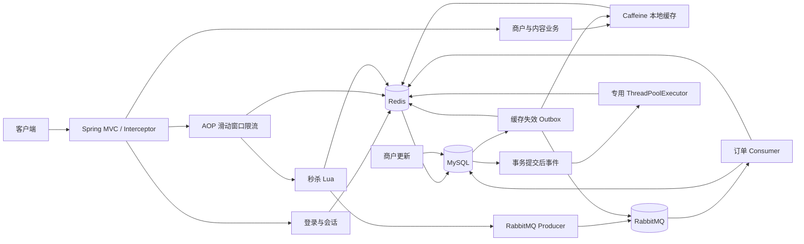
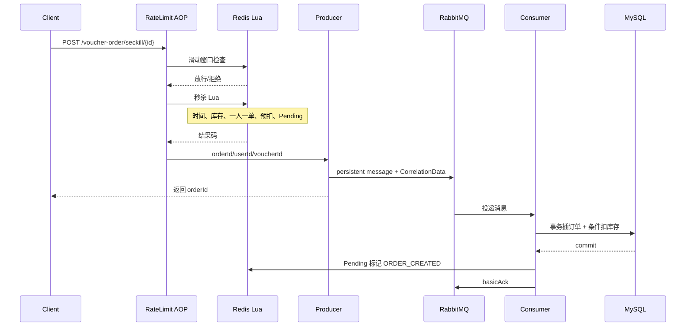
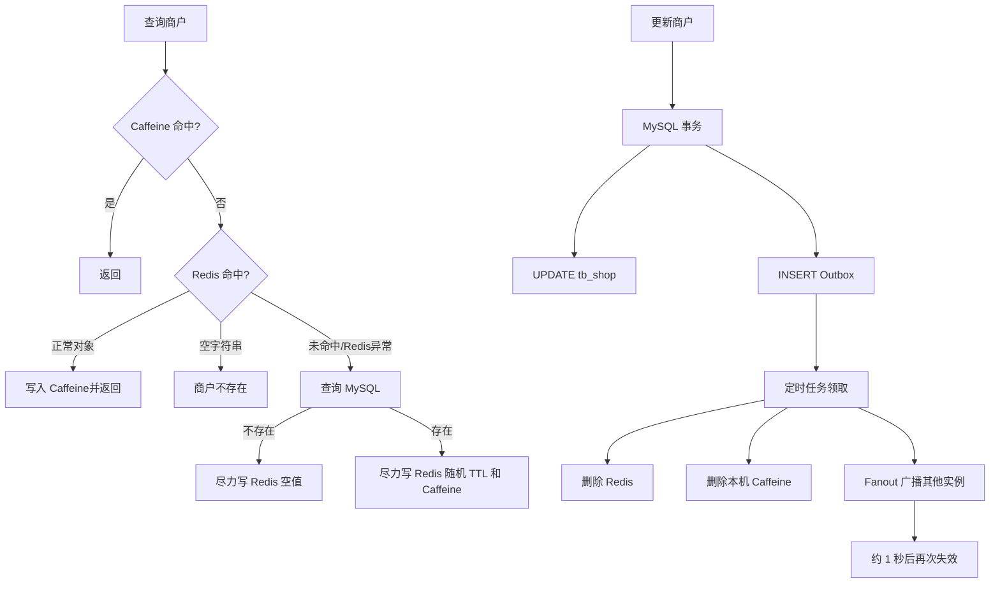

# 城享汇项目：00. 项目面试总览

## 1. 项目定位

**项目名称：** 城享汇：本地生活高并发服务平台 
**项目性质：** 本地生活点评与优惠券秒杀后端 
**核心技术：** Java 8、Spring Boot 2.7.3、MyBatis-Plus 3.4.3、MySQL、Redis、Lua、RabbitMQ、Caffeine、Spring AOP、Redisson、JMeter、Docker Compose；Nginx 在本地开发中用于静态图片目录，但仓库不包含完整的 Nginx 反向代理或负载均衡配置。

该项目包含两类能力：

- 业务能力：验证码登录、Token 会话、商户查询、附近商户、签到、探店笔记、点赞排行、关注关系、关注流、普通券与秒杀券。
- 工程能力：Redis Lua 原子秒杀、RabbitMQ 异步落库与可靠性补偿、Caffeine + Redis 二级缓存、Transactional Outbox 缓存失效、Redis 滑动窗口限流、Snowflake ID、事务提交后的异步统计、JMeter 性能测试。

## 2. 可直接用于面试的项目介绍

### 2.1 30 秒版本

> 城享汇是一个本地生活点评与优惠券秒杀平台。我主要围绕高并发链路做了工程化改造：秒杀入口先通过 AOP 和 Redis Lua 做滑动窗口限流，再用另一段 Lua 原子完成活动时间、库存和一人一单校验，同时预扣库存并登记 Pending；请求通过 RabbitMQ 异步落库。消息链路补充了 Confirm、Return、手动 ACK、延迟重试、最终失败队列、停车队列和 Pending 定时补偿，数据库用唯一索引和库存条件更新兜底。商户详情使用 Caffeine、Redis、MySQL 三级读取，并通过事务 Outbox、Fanout 广播、延迟双删和 TTL 实现多实例下的最终一致性。

### 2.2 1 分钟版本

> 城享汇面向本地生活场景，支持验证码登录、商户名称和分类查询、Redis GEO 附近商户、Bitmap 签到、探店笔记、关注互动以及优惠券秒杀。项目最核心的是秒杀和缓存两条链路。
>
> 秒杀请求先经过注解式滑动窗口限流。业务 Lua 使用相同 voucherId Hash Tag 的多个 Redis Key，在一次脚本中校验活动时间、判断库存、检查一人一单、预扣库存并记录 Pending，之后把只包含 orderId、userId、voucherId 的消息交给 RabbitMQ。消费者在事务中先插订单、再用 `stock > 0` 条件扣减 MySQL 库存，成功后 ACK；主键和 `user_id + voucher_id` 唯一索引负责重复消息幂等。生产或消费失败通过 Confirm、Return、TTL 重试队列、最终失败队列、停车队列及 Pending 重投收敛。
>
> 商户详情先查 Caffeine，再查 Redis，最后回源 MySQL；空值缓存防穿透，随机 TTL 降低雪崩。商户更新和缓存失效事件在同一 MySQL 事务提交，后台 Outbox 任务删除 Redis 和本机缓存，并通过 Fanout 广播其他实例，失败时指数退避重试，首次成功后再做一次延迟失效。

### 2.3 3 分钟结构

建议按以下顺序展开，而不是一次讲完所有技术名词：

1. 业务背景：本地商户与优惠券秒杀，读多写少和瞬时抢购并存。
2. 普通业务：登录、商户搜索、GEO 附近商户、Bitmap 签到、内容互动。
3. 秒杀挑战：高并发、超卖、一人一单、数据库压力、消息丢失和重复消费。
4. 秒杀方案：入口限流 → Lua 原子预扣 → RabbitMQ 异步落库 → 数据库双重兜底 → 失败补偿。
5. 缓存挑战：热点商户访问、穿透、雪崩、多实例本地缓存一致性。
6. 缓存方案：Caffeine → Redis → MySQL，配合 Outbox、广播、延迟双删和 TTL。
7. 验证结果：同条件 1000 用户/1 秒压测中，同步下单平均 345ms，异步受理平均 10ms；另一组 20 秒爬坡端到端测试的最终完成平均 266.80ms、P95 1424ms。
8. 主动说明边界：最终一致性不是强一致；项目的高可用中间件部署、监控告警和全链路压测仍可继续完善。

## 3. 系统架构

## 4. 简历内容逐条映射

| 简历内容 | 当前实现 | 结论 |
|---|---|---|
| 用户登录 | 手机号格式校验，验证码存 Redis 2 分钟；验证码登录后创建随机 Token，用户摘要存 Redis Hash；拦截器续期并用 ThreadLocal 传递用户 | 已实现验证码登录；当前登录逻辑未实现密码校验，不要说“密码登录” |
| 商户查询 | 支持按 ID、名称模糊匹配、类型分页；详情走二级缓存 | 已实现 |
| 附近商户 | Redis GEO 按类型存放坐标，5km 内按距离升序，截取分页后回 MySQL 批量查询并保持 GEO 顺序 | 已实现；GEO 初始化由测试/数据准备完成 |
| 签到 | 每用户每月一个 Redis Bitmap；签到 SETBIT，连续签到用 BITFIELD 和位运算统计 | 已实现 |
| 优惠券秒杀 | 限流、Lua 预扣、Pending、RabbitMQ 异步落库、状态轮询 | 已实现 |
| Redis Lua 原子校验 | 一次脚本完成重复预占、旧数据兼容、活动时间、库存、预扣、用户预占和 Pending 登记 | 已实现，且 Key 使用 Hash Tag 兼容 Redis Cluster 多 Key Lua |
| RabbitMQ 异步下单 | 请求线程投递 MQ 后返回 orderId，消费者事务写订单和扣 MySQL 库存 | 已实现 |
| MySQL 条件更新与唯一索引 | `stock = stock - 1 WHERE stock > 0`；`(user_id, voucher_id)` 唯一索引 | 已实现 |
| 生产者确认与路由失败 | Publisher Confirm、mandatory + Return；失败写回 Redis Pending 并调度重投 | 已实现 |
| 消息持久化与消费确认 | 持久交换机/队列、消息 persistent、消费者手动 ACK | 已实现 |
| 延迟重试、失败队列、Redis 待处理记录 | 主队列死信到 5 秒 TTL 重试队列；3 次后可靠转发最终失败队列；失败消费者还有有限重试和停车队列；Pending 定时扫描补偿 | 已实现 |
| Caffeine + Redis 二级缓存 | Caffeine → Redis → MySQL，单飞加载、降级与尽力回填 | 已实现 |
| 空值缓存、随机 TTL | Redis 空字符串 2 分钟；正常商户 30～40 分钟随机 TTL | 已实现 |
| 广播缓存失效 | MySQL Outbox 任务删除 Redis/本机缓存并通过 RabbitMQ Fanout 广播其他实例 | 已实现，而且比简历一句话更完整 |
| AOP + ZSet + Lua 限流 | 自定义注解和环绕切面；按业务 Key 与 GLOBAL/USER/IP 维度组装 Key；Lua 原子清理、计数和写入 | 已实现；秒杀当前使用 GLOBAL 维度，默认 300 请求/秒 |
| Snowflake 订单 ID | Hutool Snowflake，workerId/datacenterId 均校验 0～31 | 已实现；多实例必须分配不同节点标识 |
| 订单统计异步任务 | 事务 AFTER_COMMIT 事件交给有界 ThreadPoolExecutor，异步累加 Redis 日订单数 | 已实现 |
| 有界队列及拒绝策略 | 核心 4、最大 8、队列 200，CallerRunsPolicy；每 30 秒记录池指标 | 已实现 |
| JMeter 性能优化 | 有同步/异步、限流、缓存和端到端测试材料 | 有材料；简历的 345ms→16.57ms混用了不同测试场景，应按本文校正 |
| Redisson | 条件配置可创建 3 个客户端，测试代码演示 MultiLock | 有限实现；没有进入当前核心秒杀链路 |
| Docker | Compose 提供 RabbitMQ 和两个辅助 Redis 节点 | 有限实现；MySQL和主 Redis 仍需另行提供 |
| Nginx | 本地图片上传目录可指向 Nginx 静态资源目录 | 有限实现；无完整代理/负载均衡配置，面试中不要夸大 |

## 5. 两条最重要的请求链路

### 5.1 秒杀受理与落库

### 5.2 商户详情读取与更新

## 6. 数据与中间件职责

| 组件 | 项目中的职责 | 是否最终事实源 |
|---|---|---|
| MySQL | 用户、商户、笔记、券、订单、库存及 Outbox 持久化 | 是，业务数据最终事实源 |
| Redis | 会话、验证码、GEO、Bitmap、ZSet、热点缓存、秒杀库存/预占/Pending、统计 | 否，可重建或需与 MySQL 对账 |
| Caffeine | 单实例商户热点对象缓存 | 否，进程内副本 |
| RabbitMQ | 异步订单、重试/失败处理、缓存失效广播 | 否，负责解耦和缓冲 |
| Lua | 在 Redis 内原子执行复合读写 | 不存数据，只保证脚本内原子性 |

## 7. 一致性模型

项目没有用一个分布式事务覆盖 Redis、RabbitMQ 和 MySQL，而是按业务要求组合：

- 秒杀资格：Redis Lua 原子决定是否受理。
- 最终订单：MySQL 订单与库存事务决定是否真正创建成功。
- Redis 预扣到 MySQL 落库：通过消息、Pending 状态、定时重投和失败恢复实现最终收敛。
- 商户更新：MySQL 与 Outbox 同事务；缓存通过异步失效、重试、延迟双删和 TTL 达到最终一致。
- 重复消息：允许至少一次投递，消费者用数据库约束实现幂等，而不是幻想消息绝不重复。

## 8. 当前项目边界与诚实表达

以下内容需要主动控制表述：

- 登录当前是验证码登录，短信发送只是日志模拟；数据库虽有 password 字段，但登录服务没有密码校验分支。
- 热点缓存解决了大量 Redis 访问，但 Redis Key 失效瞬间没有额外的分布式互斥锁；Caffeine 的原子加载只在单 JVM 内合并并发回源。
- Outbox 查询加条件 claim 能避免同一事件被多个实例同时处理，但 `findDue` 是普通查询，不是 `SKIP LOCKED`；依赖后续条件更新竞争领取。
- Pending 补偿任务会先遍历所有秒杀券，再逐券扫描 ZSet；数据规模很大时应维护活动券集合或按分片调度。
- RabbitMQ、Redis、MySQL 高可用集群和完善监控告警不在当前仓库交付范围内。
- Redisson 只是可选配置和 MultiLock 演示，不是秒杀一人一单的核心实现。
- Nginx 仅能从图片目录使用痕迹确认，不能声称已实现完整反向代理、负载均衡或网关治理。
- Blog 的公共热门查询会进入 `isBlogLiked`，当前实现对未登录用户的 ThreadLocal 判空顺序存在改进空间；不要把内容模块包装成生产级成熟系统。

## 9. 面试收尾表达

> 这个项目让我形成了一个比较明确的工程思路：高并发系统不能只看正常路径，而要把“受理成功之后会不会丢、重复了怎么办、某个中间件失败后怎么恢复、最终状态如何被客户端观察”都设计出来。项目里我没有追求跨组件强一致，而是通过 Redis 原子操作、数据库事务与约束、可靠消息、可持久化补偿状态以及可观测的压测指标，让关键链路最终可收敛、可验证。
