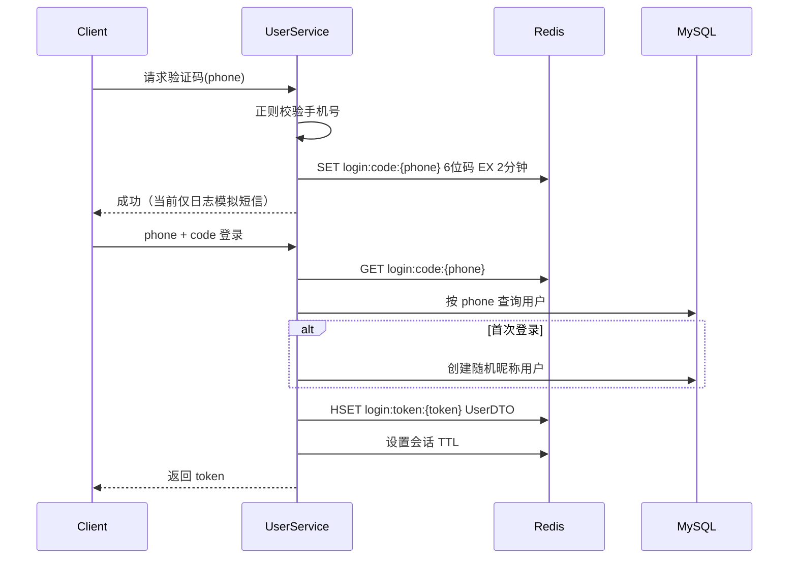

# 城享汇项目：01. 业务功能与请求链路

## 1. 用户登录与会话

### 1.1 业务入口

- `POST /user/code?phone=...`：生成验证码。
- `POST /user/login`：验证码登录。
- `POST /user/logout`：删除 Token 会话。
- `GET /user/me`：返回当前用户摘要。
- `PUT /user/info`：维护昵称、头像、城市、简介、性别和生日。

### 1.2 验证码登录链路



关键设计：

- 验证码在 Redis 中保存 2 分钟，避免依赖单机 HttpSession。
- 登录成功只缓存 `UserDTO`，不把手机号、密码等完整实体放进会话。
- Token 使用无连字符 UUID，由客户端放在 `authorization` 请求头。
- Redis Hash 便于读取与局部更新昵称、头像。
- 手机号有 MySQL 唯一索引，阻止并发注册产生多个账号。

### 1.3 双拦截器模型

请求先经过 `RefreshTokenInterceptor`，再经过 `LoginInterceptor`：

1. 刷新拦截器覆盖所有路径。
2. 如果请求头没有 Token，直接继续，公共接口仍可访问。
3. 如果 Token 对应 Redis Hash 存在，把它转换为 `UserDTO` 写入 `UserHolder` 的 ThreadLocal，并刷新 TTL。
4. 登录拦截器只检查 ThreadLocal；需要登录且没有用户时返回 HTTP 401。
5. 请求结束后刷新拦截器清理 ThreadLocal，防止线程复用造成用户串号或内存泄漏。

设计价值：身份解析和登录强制校验分开；公共接口也能识别“可选登录用户”，私有接口则统一拦截。

### 1.4 会话 TTL 的实现细节

配置常量 `LOGIN_USER_TTL = 36000`，创建 Token 时使用的是 **天**，刷新时使用的是 **分钟**。这会导致新建会话初始过期时间非常长，而首次访问后变成 36000 分钟。面试中不应把具体 TTL 说成经过严谨设计；更合理的改进是统一时间单位，用 `Duration` 配置并增加测试。

### 1.5 实现边界

- 当前真实实现是验证码登录，不是密码登录。
- “发送短信”没有接第三方短信服务，只记录调试日志。
- 登录成功后没有立即删除验证码，验证码在剩余 TTL 内仍可被再次使用；生产系统应消费后删除或限制次数。
- 当前没有验证码发送频控，这可以复用项目已有的注解式限流。

## 2. 商户查询

### 2.1 支持的查询方式

| 接口 | 功能 | 数据源 |
|---|---|---|
| `GET /shop/{id}` | 查询商户详情 | Caffeine → Redis → MySQL |
| `GET /shop/of/name` | 名称模糊分页 | MySQL `LIKE` + MyBatis-Plus 分页 |
| `GET /shop/of/type` | 按类型分页 | 无坐标时查 MySQL，有坐标时走 Redis GEO |
| `GET /shop-type/list` | 商户类型列表 | Redis String，未命中查 MySQL并回填 |
| `PUT /shop` | 更新商户 | MySQL事务 + 缓存失效 Outbox |

名称检索使用 `LIKE name`，每页 10 条。当前没有 Elasticsearch，因此不要说实现了分词、相关度排序或复杂搜索。

### 2.2 商户详情

详情查询的主要目的不是复杂 SQL，而是承载二级缓存：

```text
shopLocalCache.getIfPresent(id)
  -> Redis GET cache:shop:{id}
     -> MySQL SELECT BY ID
        -> Redis 回填（30～40 分钟随机 TTL）
        -> Caffeine 回填（写后 60 秒过期）
```

不存在的商户在 Redis 写入空字符串 2 分钟，Caffeine 不缓存 null。完整一致性设计见缓存专题。

## 3. 附近商户

### 3.1 Redis GEO 数据模型

每一种商户类型对应一个 GEO Key：

```text
shop:geo:{typeId}
member = shopId
longitude = shop.x
latitude = shop.y
```

项目中的数据准备测试会把 MySQL 商户按 `type_id` 分组，再批量写入 Redis GEO。

### 3.2 查询步骤

请求参数包含 `typeId`、`current`、`x` 和 `y`：

1. 若 x/y 缺失，按类型从 MySQL 普通分页。
2. 若坐标存在，计算 `from=(current-1)*10`、`end=current*10`。
3. 对 `shop:geo:{typeId}` 执行半径 5 公里搜索，要求返回距离、按距离升序，并限制前 end 条。
4. 在应用层跳过 from 条，实现分页截取。
5. 取出 shopId 列表和每个商户的距离。
6. MySQL 使用 `WHERE id IN (...) ORDER BY FIELD(id, ...)` 批量查询并保持 Redis 距离排序。
7. 把距离写入响应对象的非持久字段。

### 3.3 为什么不能直接只返回 GEO 结果

Redis GEO 只保存 shopId 和坐标索引，不包含商户名称、图片、评分等业务字段；所以 GEO 负责“候选集合和距离排序”，MySQL 负责“完整对象”。

### 3.4 分页细节

Redis GEO 查询没有传统数据库 offset，因此先取前 `current * pageSize` 条，再在应用层 skip。页数越深，前置读取越多，因此该方式适合附近结果较少的本地生活场景。大规模深分页可以改用距离和 shopId 作为游标。

## 4. 用户签到

### 4.1 Bitmap Key

```text
sign:{userId}:{yyyy-MM}
```

每个用户每个月一个 Bitmap；第 N 天对应 offset `N-1`。

签到操作等价于：

```text
SETBIT sign:{userId}:{yyyy-MM} dayOfMonth-1 1
```

一个月最多 31 位，空间远小于每天插入一条签到记录。

### 4.2 连续签到统计

1. 用 `BITFIELD key GET u{dayOfMonth} 0` 取本月第 1 天到今天的位图，并转成整数。
2. 从最低位开始执行 `num & 1`。
3. 若为 1，连续天数加一并无符号右移；若为 0，终止。

伪代码：

```java
count = 0;
while ((num & 1) == 1) {
    count++;
    num >>>= 1;
}
```

这里统计的是“截至今天向前连续签到多少天”，不是本月累计签到天数。

### 4.3 边界

- 月份切换自动使用新 Key，不需要清空旧位图。
- 当前没有给签到 Key 显式设置 TTL；数据会长期保留，可按业务保留周期设置过期。
- Bitmap 适合只记录是否签到；若要保存签到地点、奖励或补签明细，还需数据库流水。

## 5. 探店笔记与互动

虽然简历重点不在内容模块，但它构成了完整的本地生活业务背景。

### 5.1 笔记发布与关注流

发布笔记时：

1. 从 ThreadLocal 取得作者 ID并保存笔记到 MySQL。
2. 查询作者所有粉丝。
3. 对每个粉丝写入 `feed:{fanId}` ZSet：member 是 blogId，score 是发布时间戳。

这是推模式 Feed：发布时写扩散，读取时成本低，适合粉丝规模有限的练习项目。大 V 场景可以改成推拉结合。

关注流读取使用 `ZREVRANGEBYSCORE` 思路，按时间戳倒序滚动分页。返回 `minTime` 与 `offset`，offset 用于处理多条内容时间戳相同导致的重复或漏读。

### 5.2 点赞与排行榜

- MySQL `liked` 字段保存笔记总点赞数。
- Redis `blog:liked:{blogId}` ZSet 保存点赞用户，score 为点赞时间。
- 点赞时 MySQL `liked+1` 后写 ZSet；取消时 `liked-1` 后移除。
- 读取前 5 位点赞用户后，MySQL 用 `ORDER BY FIELD` 保持 ZSet 顺序。

这不是严格的跨 MySQL/Redis 事务，异常时可能短暂不一致。生产级设计可用消息或 Outbox 使点赞计数最终收敛。

### 5.3 关注与共同关注

- MySQL `tb_follow` 保存关注关系。
- Redis `follows:{userId}` Set 保存关注对象。
- 共同关注通过两个 Set 的 `SINTER` 求交集，再批量查询用户信息。

### 5.4 当前内容模块限制

- 评论 Controller 为空，不能声称已实现评论业务。
- 热门笔记是按 MySQL `liked` 和创建时间排序，不是复杂热度公式。
- 公共热门接口调用点赞状态判断时，对未登录用户存在空指针改进点。
- 关注表当前 DDL 未声明 `(user_id, follow_user_id)` 唯一索引，应用层先查后写仍可能在极端并发下重复；生产上应增加唯一约束。

## 6. 优惠券基础业务

- 普通券直接写 `tb_voucher`。
- 秒杀券同时写 `tb_voucher` 和 `tb_seckill_voucher`，然后把库存写入 Redis。
- 秒杀活动开始、结束时间写入 Redis Hash，与库存 Key 使用相同 voucherId Hash Tag。
- 商户券列表通过自定义 Mapper 联表返回普通券与秒杀信息。

新建秒杀券时数据库写入在事务中，但 Redis 初始化属于事务外部资源；若 Redis 写失败，数据库事务是否回滚取决于异常传播，但即使回滚，外部 Redis 写也不具备事务原子性。生产上更稳妥的方式是数据库提交后通过初始化任务或 Outbox 同步 Redis。

## 7. 功能面试问法示例

### 为什么登录信息放 Redis，不用 Session？

因为多实例下本地 Session 需要粘性会话或额外同步。Token + Redis 让任意实例都能解析登录状态，也能集中控制过期与登出。代价是每个需要身份的请求会访问 Redis，所以要关注 Redis 可用性和连接池。

### 为什么签到用 Bitmap？

签到是天然的布尔状态，一个月最多 31 位。Bitmap 空间紧凑，还可以用 BITFIELD 一次取出本月至今的状态，再通过位运算统计连续天数。

### 为什么附近商户还要查 MySQL？

GEO 只负责空间索引和距离排序，完整商户字段仍在 MySQL。先用 Redis 缩小集合，再批量查库，可以兼顾距离计算效率和数据完整性。

### Feed 为什么用 ZSet？

发布时间戳作为 score 天然支持倒序和按 score 游标滚动分页；相同时间戳用 offset 消除分页边界重复。
