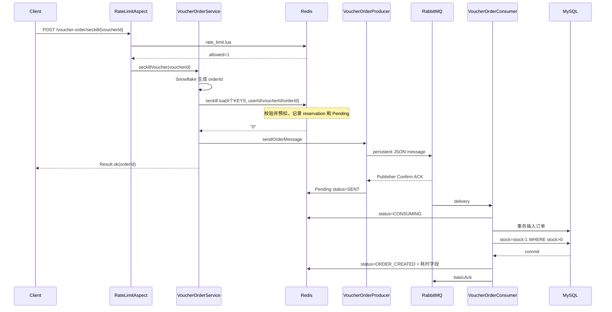
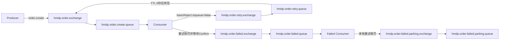

# 城享汇项目：02. 秒杀下单与 RabbitMQ 可靠性

## 1. 要解决的问题

秒杀不是简单的“库存减一并插入订单”，而是同时面对：

- 瞬时流量远大于数据库处理能力。
- 多请求并发读取同一库存，可能超卖。
- 同一用户重复点击或请求重试，可能重复下单。
- Redis 预扣成功后，MQ 发送可能失败。
- 消息可能重复投递、消费异常或消费者宕机。
- Redis 库存和 MySQL 库存分别变化，需要最终收敛。
- 异步接口立即返回后，客户端需要知道订单最终是否成功。

项目采用的核心思路是：**入口削峰、Redis 原子受理、RabbitMQ 异步解耦、MySQL 最终兜底、Pending 状态补偿、客户端状态查询。**

## 2. 正常链路



接口返回 orderId 只表示系统已经受理，不代表数据库订单已经创建。客户端通过：

```http
GET /voucher-order/status/{orderId}?voucherId={voucherId}
```

查询 `PROCESSING / COMPLETED / FAILED / NOT_FOUND`。

## 3. Redis 数据模型

同一张券的 Key 都带 `{voucherId}` Hash Tag，使 Redis Cluster 把它们映射到同一个 slot，允许 Lua 操作多个 Key。

| Key | 类型 | 作用 |
|---|---|---|
| `seckill:stock:{voucherId}` | String | Redis 可售库存 |
| `seckill:time:{voucherId}` | Hash | `beginTimeMillis`、`endTimeMillis` |
| `seckill:reservation:{voucherId}` | Hash | field=userId，value=orderId；新版本一人一单预占 |
| `seckill:order:{voucherId}` | Set | 兼容旧版本的一人一单记录 |
| `seckill:pending:{voucherId}` | ZSet | member=orderId，score=下次重投时间 |
| `seckill:pending:data:{voucherId}:{orderId}` | Hash | 订单投递状态、用户、券、重试次数、各阶段时间 |
| `seckill:pending:failed:{voucherId}` | ZSet | 最终失败的订单 ID |

Pending Hash 默认保存 24 小时，既供补偿任务使用，也供客户端短期查询异步状态。

## 4. 秒杀 Lua 为什么是核心

### 4.1 一次脚本完成的动作

脚本按以下顺序执行：

1. 读取 reservation，若用户已有预占，返回 `EXISTS:{orderId}`，不再扣库存。
2. 查询旧版本 Set，若已存在则返回 `LEGACY_EXISTS`。
3. 从 Redis 服务端 `TIME` 获取时间，校验活动开始和结束时间。
4. 检查库存 Key 是否存在且大于 0。
5. `INCRBY stock -1` 预扣库存。
6. `HSET reservation userId orderId` 记录预占所有权。
7. `ZADD pending now orderId` 登记待投递订单。
8. 写 Pending Hash，状态为 `PENDING`、重试次数为 0，并设置 24 小时 TTL。

结果码：

| 返回值 | 含义 |
|---|---|
| `0` | 新订单受理成功 |
| `EXISTS:{orderId}` | 用户已有新版本预占 |
| `LEGACY_EXISTS` | 用户存在旧版本下单记录 |
| `1` | 库存不足 |
| `2` | 活动尚未开始 |
| `3` | 活动已结束 |
| `4` | 活动时间未初始化 |

### 4.2 为什么不用 Java 依次执行 Redis 命令

如果在 Java 中先查库存、再查用户、再减库存，这些命令之间会被其他请求穿插，两个请求可能同时通过检查。Lua 在 Redis 中作为一个不可被其他命令插入的脚本执行，使复合判断和写入成为一个原子单元。

### 4.3 为什么使用 Redis 服务端时间

活动时间校验使用 `TIME`，避免多应用实例的系统时钟漂移，而且时间校验与预扣库存仍在同一个脚本内。

### 4.4 为什么订单号作为字符串返回

Snowflake ID 常超过 Lua number 和 JavaScript number 的安全整数精度。脚本用 `'EXISTS:' .. orderId` 返回字符串，避免先转浮点数造成精度丢失。

### 4.5 “一人一单”的准确语义

当前方案会阻止同一用户对同一券再次预扣库存。脚本能够找回原 orderId，但 Java 服务收到 `EXISTS:` 后返回的是“已经抢到，无法再抢”的失败结果，而不是把原 orderId 再返回给客户端。因此它实现了**业务去重**，但响应语义还不是完整的“重试返回同一结果”幂等。若要做到严格接口幂等，应把原 orderId 返回给客户端。

## 5. 为什么先生成订单 ID

请求进入 Lua 前由 Hutool Snowflake 在 JVM 内生成 orderId。这样 Redis 预占、Pending、MQ 消息、MySQL 主键和状态查询都使用同一个业务 ID，不需要等数据库自增 ID 返回。

消息体只包含：

```json
{
  "orderId": 2090000000000000000,
  "userId": 1010,
  "voucherId": 11
}
```

真实传输使用 JSON 转换器。Long 对前端可能超过 JavaScript 安全整数，生产接口应统一序列化为字符串。

## 6. RabbitMQ 拓扑

### 6.1 主链路与重试



交换机和业务队列都声明为 durable；订单消息显式设置为 persistent。

### 6.2 重试次数

消费者从 RabbitMQ `x-death` Header 中读取主队列因 `rejected` 产生的死亡次数：

- 未超过 3 次：`basicReject(requeue=false)`，消息进入 5 秒重试队列，TTL 到期后回主队列。
- 达到 3 次：把消息发送到最终失败交换机，等待 Confirm 成功并确认没有 Return 后，才 ACK 原消息。
- 最终失败消费者自身最多尝试 4 次（首次 + 3 次重试），退避 1 秒、2 秒、4 秒，上限 5 秒；仍失败则可靠转发停车队列。

这样避免直接 `requeue=true` 形成无间隔的 CPU 和日志风暴。

## 7. 生产端可靠性

### 7.1 Publisher Confirm

每条订单消息携带 `CorrelationData = orderId:voucherId`：

- ACK：Broker 已收到消息，Pending Hash 标记 `SENT`，从待重投 ZSet 移除。
- NACK：Pending 标记 `BROKER_NACK`，写入失败原因和下次重试时间，重新加入 ZSet。

Confirm 只说明消息到达 Broker，不说明：

- 一定路由到队列；这由 Return 处理。
- 一定写入磁盘；持久化还取决于队列、消息和 Broker 策略。
- 一定消费成功；这由消费者 ACK 和业务落库保证。

### 7.2 Return

RabbitTemplate 设置 `mandatory=true`。Exchange 存在但 routing key 无法路由时触发 Return：

- Pending 标记 `ROUTE_FAILED`。
- 保存 replyCode、replyText、exchange 和 routingKey。
- 把订单重新放进待重投 ZSet。

代码在 Confirm ACK 写 `SENT` 前检查是否已经是 `ROUTE_FAILED / BROKER_NACK / CONSUMING / ORDER_CREATED / FAILED`，避免 ACK 覆盖更明确的失败或后继状态。

这里仍是 Redis 的“先读状态、再写状态”两步操作，不是 Lua/CAS 原子状态机；极端回调竞态下还可以继续改造成 Lua 条件更新。

### 7.3 convertAndSend 直接抛异常

接口捕获 `AmqpException`，把 Pending 标为发送失败，但仍向客户端返回 orderId。理由是 Redis 已经完成资格预占，Pending 任务可以在 RabbitMQ 恢复后补发；如果直接告诉用户“失败”却不恢复预扣，用户会误以为可以重新抢。

## 8. Pending 补偿任务

定时任务每 10 秒执行：

1. 查询全部秒杀券。
2. 按 voucherId 从对应 Pending ZSet 取出 score 小于当前时间的前 100 个订单。
3. 先按 orderId 查 MySQL。
4. 若订单已存在，说明业务已经成功，只清理 Pending。
5. 若 Pending Hash 缺失，标记最终失败。
6. 若重投次数达到 10，执行恢复 Lua，再进入 failed ZSet。
7. 否则增加 retryCount、标记 `REPUBLISHING` 并重新发消息。

退避间隔按 `10s × 2^retryCount` 计算，上限 300 秒。

先查 MySQL 很重要：消息可能已经消费成功，只是 Confirm、网络响应或 Pending 清理丢失。如果不查库直接恢复库存，可能把已售库存加回去。

### 可扩展点

当前任务每轮遍历 `tb_seckill_voucher` 全表。大规模系统应维护“活跃券集合”、按 voucherId 分片扫描，或把补偿任务交给分布式调度平台。

## 9. 消费者事务、幂等与超卖保护

### 9.1 数据库事务

消费者构造 `VoucherOrder` 后调用事务方法：

```text
BEGIN
  INSERT INTO tb_voucher_order(id, user_id, voucher_id, ...)
  UPDATE tb_seckill_voucher
     SET stock = stock - 1
   WHERE voucher_id = ? AND stock > 0
COMMIT
```

若库存更新 0 行，抛异常，前面的订单插入一起回滚。

### 9.2 两层数据库幂等约束

`tb_voucher_order` 有：

- 主键 `id`：同一个消息重复投递时冲突。
- 唯一索引 `uk_user_voucher(user_id, voucher_id)`：同一用户即使拿到不同 orderId，也不能购买同一张券两次。

消费者捕获 `DuplicateKeyException` 后把消息视为已经处理或业务重复，清理 Pending 并直接 ACK，不再重试。

### 9.3 两层库存保护

- Redis Lua 是入口主防线，使受理数量不超过 Redis 库存。
- MySQL `stock > 0` 是最终防线，即便 Redis 数据异常或重复消息绕过前置判断，也不会把数据库库存扣成负数。

Redis 库存承担高并发判定，MySQL 库存承担最终业务账本，两者通过异步落库和补偿最终收敛。

## 10. 最终失败与库存恢复

失败队列消费者先查 MySQL：

- 订单存在：不恢复库存，只清理 Pending 并 ACK。
- 订单不存在：执行 `seckill_restore.lua`。

恢复 Lua 的关键条件：

```text
只有 reservation[userId] 仍等于当前 orderId，才：
  Redis 库存 +1
  删除该用户 reservation
  从 Pending ZSet 移除 orderId
```

这种“所有权比较后恢复”同时解决两个问题：

- 幂等：第一次恢复后 reservation 被删除，重复失败消息不会再次加库存。
- 防误删：如果用户后来拥有另一个 orderId，旧订单的补偿不会删除新预占。

脚本还兼容旧版本 Set，但只有不存在新 reservation 时才释放旧记录。

## 11. 手动 ACK 的语义

消费者只在以下情况 ACK：

- 事务成功并更新 Pending 后。
- 唯一索引表明是重复消息。
- 原消息已经可靠转发到最终失败队列。

异常且未耗尽重试时使用 reject 进入延迟队列；向最终失败队列发送失败时用 `basicNack(requeue=true)` 保留原消息。

必须强调：手动 ACK 不能保证 exactly-once。数据库提交后、ACK 前消费者宕机，Broker 会重投，所以系统按“至少一次投递 + 业务幂等”设计。

## 12. 状态模型与可观测性

Pending Hash 的典型状态：

```text
PENDING -> SENT -> CONSUMING -> ORDER_CREATED
    |         |         |
    |         |         +-> 消费异常 -> 重试/失败队列
    |         +-> 长时间排队时客户端仍看到 PROCESSING
    +-> BROKER_NACK / ROUTE_FAILED -> REPUBLISHING -> SENT
                                      -> FAILED
```

保存的时间字段：

| 字段 | 含义 |
|---|---|
| `createTime` | Lua 受理并登记 Pending 的应用时间 |
| `consumeStartTime` | 消费者开始处理 |
| `dbCommittedTime` | 事务方法返回后的时间 |
| `queueDelayMillis` | `consumeStart - createTime` |
| `dbProcessMillis` | `dbCommitted - consumeStart` |
| `endToEndMillis` | `dbCommitted - createTime` |

状态接口优先读 Pending Hash；若 Hash 已过期或不存在，再按 orderId 查 MySQL，并校验订单属于当前用户。

## 13. 故障矩阵

| 故障点 | 当前处理 |
|---|---|
| Lua 执行失败或返回 null | 接口返回秒杀服务异常，没有产生已确认受理结果 |
| Lua 成功，发送方法抛异常 | Pending 标失败，返回 orderId，定时重投 |
| Broker NACK | Confirm 回调写 BROKER_NACK 并重投 |
| 路由失败 | Return 回调写 ROUTE_FAILED 并重投 |
| Broker ACK 后消费者暂未处理 | 消息留在 durable 队列，状态为 PROCESSING/SENT |
| 消费事务失败 | 主队列拒绝 → 5 秒重试队列 → 回主队列 |
| 重试耗尽 | 可靠发送最终失败队列后 ACK 原消息 |
| 最终失败处理异常 | 监听器有限本地重试，耗尽进入停车队列 |
| DB 已成功但 ACK 丢失 | RabbitMQ 重投，数据库唯一索引拦截并 ACK |
| Redis 预扣但最终无法建单 | 查 DB 确认不存在后，Lua 幂等恢复库存和资格 |

## 14. 面试中不要说错的点

- 不要说“RabbitMQ 保证消息绝不丢失”；应说多层机制降低丢失概率并让失败可补偿。
- 不要说“实现 exactly-once”；应说至少一次投递，数据库约束保证业务幂等。
- 不要说“Confirm ACK 表示消费成功”；它只表示 Broker 接收。
- 不要说“Redis 与 MySQL 强一致”；这是异步最终一致。
- 不要说“Lua 保证所有系统原子”；Lua 只保证 Redis 内脚本操作原子。
- 不要说“重复请求返回相同成功响应”；当前会阻止重复预扣，但服务层对已有 reservation 返回业务失败。

## 15. 可继续优化

- 用 Lua 实现 Pending 状态条件迁移，消除 Confirm/Return 竞态窗口。
- reservation 与活动数据根据活动结束时间设置合理 TTL，避免永久占用。
- Pending 扫描从“遍历所有券”改为活跃券索引和分片调度。
- 引入监控：Pending 最老年龄、重投次数、失败/停车队列深度、Confirm 延迟、消费延迟。
- 对订单创建使用本地消息表或更完整的对账任务，定期比对 Redis reservation 与 MySQL 订单。
- 给前端 Long ID 统一做字符串序列化。
