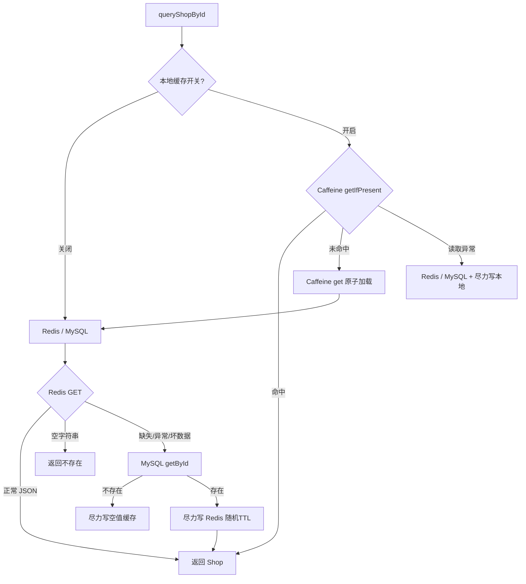
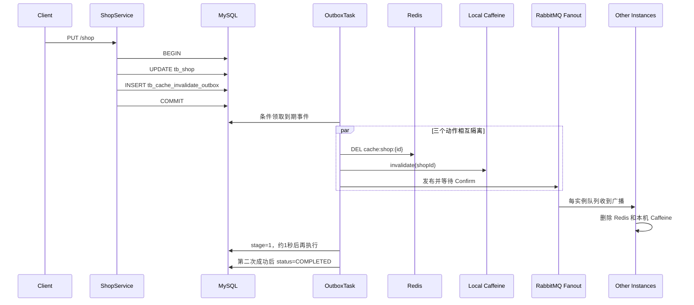

# 城享汇项目：03. Caffeine + Redis 二级缓存与最终一致性

## 1. 业务背景

商户详情属于典型读多写少数据：

- 同一个热门商户会被大量重复访问。
- Redis 可以降低 MySQL 压力，但每次访问 Redis 仍有网络与序列化成本。
- Caffeine 能在单 JVM 内以更低延迟提供热点数据。
- 引入本地缓存后，多实例之间存在多份副本，更新一致性比单 Redis 更复杂。

项目把 MySQL 定义为唯一可信数据源，Redis 和 Caffeine 都是可删除、可重建的副本，追求**最终一致性**而不是跨组件强一致。

## 2. 缓存参数与数据结构

### Caffeine

```text
key: shopId(Long)
value: Shop
maximumSize: 10,000
expireAfterWrite: 60 秒
recordStats: 开启
```

### Redis

```text
key: cache:shop:{shopId}
正常值: Shop JSON
正常 TTL: 30～40 分钟（基础 30 分钟 + 0～10 分钟随机抖动）
空值: 空字符串 ""
空值 TTL: 2 分钟
```

本地 TTL 明显短于 Redis TTL，目的是缩短多实例本地旧数据窗口，同时让热点请求尽量在 JVM 内命中。

## 3. 查询链路



### 3.1 Caffeine 命中

`getIfPresent(id)` 命中后直接返回，不访问 Redis 或 MySQL。这是热点读性能提升的主要来源。

### 3.2 Caffeine 未命中时的单 JVM 合并加载

使用 `cache.get(id, mappingFunction)`，Caffeine 对同一个 Key 的并发加载进行协调，同一 JVM 内大量并发 miss 不会都执行后端加载函数。

这只能控制**单实例**回源；多个应用实例同时 miss，仍可能一起访问 Redis 或 MySQL。

### 3.3 Redis 命中

非空 JSON 反序列化为 Shop。若 JSON 破损或缺少 ID：

1. 记录告警。
2. 尽力删除异常缓存。
3. 回源 MySQL。

### 3.4 Redis 空值命中

代码用 `json != null` 区分“空字符串”与“Key 不存在”。空字符串表示数据库曾经确认该商户不存在，直接返回 null，避免恶意请求反复穿透数据库。

### 3.5 Redis 异常降级

Redis GET 抛异常时记录日志并查询 MySQL。MySQL 成功后即使 Redis SET 失败，也仍返回查询结果。这样缓存故障不会把已经成功的数据库读取变成接口失败。

代价是 Redis 故障期间 MySQL 压力增大，生产系统还需要熔断、限流、连接池隔离与告警。

### 3.6 Caffeine 异常降级

读取或回填 Caffeine 异常时，仍尝试 Redis/MySQL，并尽可能返回已经加载成功的数据。相关单元测试验证了：

- Redis 读写失败时，仍返回 MySQL 结果。
- Caffeine 读取失败时，能降级到 Redis/MySQL。

## 4. 缓存穿透、击穿和雪崩

### 4.1 穿透

不存在的商户回源 MySQL 后，在 Redis 写空字符串并设置 2 分钟 TTL。短时间重复访问相同非法 ID 不会再次查库。

风险与改进：随机伪造大量不同 ID 仍会产生很多空 Key，可在入口做参数范围校验、限流或增加 Bloom Filter。

### 4.2 雪崩

正常商户 Key 在 30 分钟基础上增加 0～10 分钟随机 TTL，避免批量写入的 Key 在同一时刻集中失效。

随机 TTL 只能打散过期时间，不能解决 Redis 整体故障。

### 4.3 击穿

当前有效方案有一层 Caffeine 保护，并使用 Caffeine 的按 Key 原子加载合并单 JVM 并发回源。但当：

- 多实例的本地缓存同时未命中；并且
- Redis 热点 Key 也恰好过期

多个实例仍可能同时访问 MySQL。源码中存在互斥锁和逻辑过期的旧实现示例，但已被注释，不是当前实际运行链路。

因此准确表述是：**缓解了热点访问和单 JVM 击穿，没有完整实现跨实例热点 Key 的分布式互斥重建。**

## 5. 为什么更新时删除，而不是更新缓存

更新缓存需要同时修改：

- Redis 的共享副本。
- 当前实例 Caffeine。
- 其他所有实例的 Caffeine。

任何一步失败都会形成不同版本，写路径复杂。删除缓存更简单且幂等；下一次读取自然从 MySQL 重建。

## 6. 为什么简单“更新数据库后删缓存”仍不够

失败窗口包括：

1. MySQL 已提交，应用在删 Redis 前宕机。
2. Redis 删除成功，本机 Caffeine 删除失败。
3. 本机都删除成功，广播 MQ 失败，其他实例仍有旧值。
4. 删除后，一个在更新前已读到旧数据的并发查询把旧值重新写回 Redis。

项目使用 Transactional Outbox、广播、重试和延迟双删缩短这些窗口。

## 7. Transactional Outbox 更新链路



### 7.1 同事务写业务与 Outbox

商户更新方法有 `@Transactional`：

1. `updateById(shop)` 必须更新成功；0 行更新也作为异常处理。
2. 调用独立 Service 插入 Outbox 事件。
3. 任一步抛异常，商户更新和 Outbox 插入一起回滚。

这解决了“数据库改了但失效任务完全没有记录”的进程崩溃窗口。Outbox 是 MySQL 持久记录，不依赖 JVM 内存。

## 8. Outbox 状态机

表 `tb_cache_invalidate_outbox` 的关键字段：

| 字段 | 值 | 说明 |
|---|---|---|
| `stage` | 0/1 | 首次失效 / 延迟二次失效 |
| `status` | 0 | PENDING |
| `status` | 1 | PROCESSING |
| `status` | 2 | COMPLETED |
| `status` | 3 | DEAD |
| `retry_count` | 整数 | 当前阶段失败次数 |
| `next_retry_time` | 时间 | 下次执行时间；处理中时复用为租约截止时间 |
| `last_error` | 文本 | 最近失败摘要，最多 512 字符 |

表上有 `(status, next_retry_time)` 联合索引，支持扫描到期事件。

### 8.1 扫描和领取

- 默认每 1 秒扫描一次，每批 50 条。
- `findDue` 查询到期 PENDING 事件。
- `claim` 用 `WHERE id=? AND status=0` 条件更新，将事件改为 PROCESSING并设置 30 秒租约。
- 多实例即使查到同一行，也只有一个实例能更新成功并领取。
- 任务进程崩溃后，`recoverExpiredClaims` 把租约过期的 PROCESSING 事件恢复为 PENDING。

### 8.2 失败重试

三个动作——删除 Redis、删除本机 Caffeine、发布 MQ——分别 try/catch；一个失败不会阻止其他动作。只要任何一步失败，聚合异常使整个 Outbox 事件进入重试。

默认单阶段最多尝试 8 次，指数退避：1、2、4、8、16、32、60……秒。耗尽后标记 DEAD，等待告警和人工修复。

这些操作都是幂等的，因此重试时可以全部重做。

## 9. 延迟双删解决什么

典型并发窗口：

```text
查询线程读取到旧 MySQL 数据
更新线程提交新数据并第一次删除缓存
查询线程把之前读到的旧数据回填 Redis
```

首次失效成功后，Outbox 把 stage 改为 1，并将下一次执行时间设为约 1 秒后。第二次删除可以清理在竞争窗口中重新写回的旧值。

延迟时间不是普适常数，应根据查询耗时分布调整；它缩短旧值窗口，不提供严格强一致证明。

## 10. 多实例 Caffeine 失效广播

### 10.1 RabbitMQ 拓扑

- durable Fanout Exchange：`hmdp.cache.invalidate.exchange`。
- 每个应用实例创建自己的非持久、独占、自动删除队列：`hmdp.cache.invalidate.{instanceId}`。
- Fanout 把一条失效消息广播给所有在线实例。

实例离线时 JVM 和 Caffeine 已经消失，因此没有必要为该实例永久保存队列；重启后本地缓存为空。

### 10.2 发布可靠性

缓存失效使用独立 RabbitTemplate，避免和订单生产者共享 Confirm/Return 回调状态。发布端：

- 设置 mandatory。
- 消息设为 persistent。
- 等待 CorrelationData Confirm，默认最多 5 秒。
- NACK、超时或 Return 都视为失败，由 Outbox 重试。

### 10.3 消费失败

消费者同时尝试删除 Redis 和本机 Caffeine；任一步失败都抛异常。监听容器做有限重试，耗尽后通过带 Confirm 的 Recoverer 发送到缓存失效停车队列，避免无限重入。

## 11. 一致性承诺

可以承诺：

- MySQL 更新和“必须失效缓存”这条意图同事务持久化。
- 失效动作失败后可重试，进程崩溃后任务可恢复。
- 多实例在线时通过 Fanout 收到本地失效通知。
- 延迟双删和 TTL 限制旧值长期存在。

不能承诺：

- 任意时刻所有缓存与 MySQL 完全相同。
- MQ、Redis 或应用长时间故障时仍立即一致。
- 不存在任何毫秒级或秒级旧值窗口。

准确表述：**用事务 Outbox 保证失效意图不随进程崩溃丢失，再通过幂等失效、可靠广播、退避重试、延迟双删和 TTL 实现最终一致性。**

## 12. 性能效果

已有热点读测试对 `GET /shop/1` 执行 1000 线程、每线程 100 次，共 100,000 次请求：

| 场景 | P95 | P99 | Throughput | Redis GET 增量 |
|---|---:|---:|---:|---:|
| 关闭 Caffeine | 3ms | 4ms | 3297.3/s | 约 100,003 |
| 开启 Caffeine | 1ms | 1ms | 3320.8/s | 约 2 |

最明显收益不是吞吐量，而是 Redis 热点访问量和尾延迟下降。该测试环境中吞吐量只提升约 0.7%，因此不要夸大为“吞吐量提升数倍”。

## 13. 面试高频追问

### Caffeine 不是分布式缓存，为什么还用？

它服务于单实例内的极热点读，纳秒/微秒级访问且没有网络开销。分布式一致性通过短 TTL 和 MQ 广播失效处理；如果业务不能容忍短暂旧值，就不应使用这种本地缓存策略。

### 为什么不用 Redis Pub/Sub？

Pub/Sub 对离线订阅者不保留消息，也缺少现有的 Confirm、重试和停车队列治理。项目已经使用 RabbitMQ，因此复用其可靠投递能力更统一。实例离线时本地缓存也随 JVM 消失，所以使用自动删除实例队列合理。

### Outbox 为什么比事务提交后直接发 MQ 更可靠？

直接发 MQ 仍有数据库提交成功后进程立刻崩溃的窗口。Outbox 和业务更新在同一数据库事务中，提交后即使应用崩溃，另一实例或重启后的扫描任务仍能找到事件。

### 为什么消费者还删 Redis？发布端不是已经删了吗？

删除是幂等的。消费者重复删除既可以弥补发布端 Redis 删除失败，也能让广播处理逻辑统一；代价只是一次额外操作。

## 14. 可继续优化

- Redis 热点 miss 时增加分布式互斥重建或逻辑过期，解决跨实例击穿。
- Outbox 扫描使用数据库 `SKIP LOCKED`、分区或 CDC，提升大规模吞吐。
- 增加 Outbox 最老事件年龄、DEAD 数量、停车队列深度和失效耗时监控。
- 按缓存价值配置不同的本地 TTL 和最大容量，避免一套参数覆盖所有对象。
- 商户类型缓存目前没有 TTL 和失效链路，应补充版本或更新事件。
- 为缓存消息增加 schema/version 字段，支持演进和未知版本拒绝策略。
