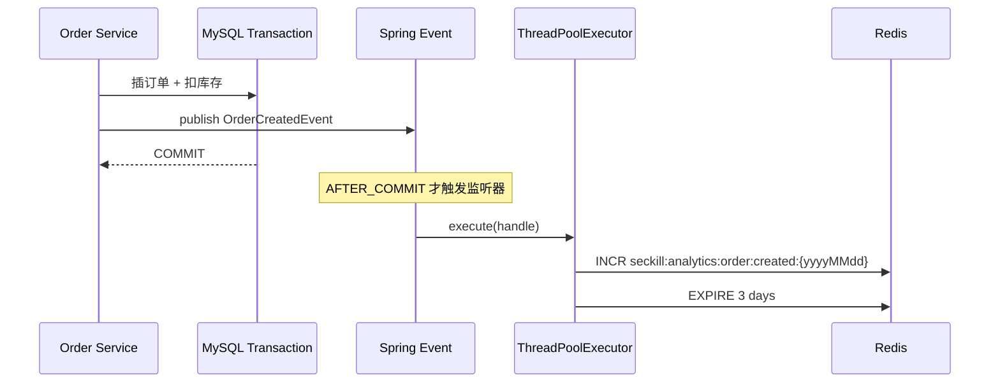

# 城享汇项目：04. 分布式限流、Snowflake ID 与异步任务

## 1. 注解式滑动窗口限流

### 1.1 使用方式

秒杀 Controller 在方法上声明：

```java
@RateLimit(
    key = "'seckill:' + #p0",
    maxCount = "${hmdp.rate-limit.seckill.max-count:300}",
    windowSeconds = "${hmdp.rate-limit.seckill.window-seconds:1}",
    scope = GLOBAL,
    message = "当前抢购人数过多，请稍后再试"
)
```

默认含义是：同一个 voucherId 的秒杀入口，在任意 1 秒滑动窗口内最多放行 300 个请求。

### 1.2 组件职责

| 组件 | 职责 |
|---|---|
| `@RateLimit` | 声明业务 Key、阈值、窗口、维度和提示语 |
| `RateLimitScope` | 支持 GLOBAL、USER、IP |
| `RateLimitAspect` | 拦截方法、解析配置与 SpEL、组装 Redis Key、执行 Lua |
| `rate_limit.lua` | 原子删除过期记录、计数、判断、写入本次请求和设置 TTL |

Spring Boot 启用了 AspectJ 自动代理，因此 Controller 方法调用前会先进入环绕切面。

### 1.3 Key 设计

最终 Redis Key：

```text
rate:limit:{businessKey}:{scope}:{scopeValue}
```

秒杀全局限流示例：

```text
rate:limit:seckill:11:global:global
```

三种维度：

- GLOBAL：所有用户共享一个窗口，适合保护某张券的总体处理容量。
- USER：追加登录 userId，未登录为 anonymous，适合单用户操作频控。
- IP：追加远端 IP，适合匿名接口；若经过反向代理，生产上应安全解析可信代理头，而不能直接相信任意 `X-Forwarded-For`。

### 1.4 Lua 算法

ZSet 中：

- score = 当前毫秒时间戳。
- member = `scopeValue:now:randomLong`，避免同毫秒请求覆盖。

Lua 伪代码：

```lua
ZREMRANGEBYSCORE key 0 now-window
count = ZCARD key
if count >= maxCount then
    EXPIRE key windowSeconds+1
    return 0
end
ZADD key now requestId
EXPIRE key windowSeconds+1
return 1
```

删除、计数、判断和写入在一个脚本中执行，不会出现多个实例同时读到 count 未满并都放行的问题。

### 1.5 为什么是滑动窗口

固定窗口在边界上可能突发两倍流量。例如前一秒最后 100ms 和下一秒最初 100ms 各放 300 次，200ms 内可能通过 600 次。滑动窗口始终统计“当前时刻向前 1 秒”，边界更平滑。

代价是每个请求需要保存一条 ZSet 成员，并执行清理与计数，内存和 CPU 成本高于简单计数器。

### 1.6 SpEL 与配置缓存

- `key` 支持 `#p0`、`#a0` 和方法参数名，允许按 voucherId 生成业务 Key。
- maxCount 和 windowSeconds 支持 Spring 配置占位符。
- 已解析的 SpEL Expression 和占位符结果缓存在 `ConcurrentHashMap`，避免每次请求重复解析。

由于占位符结果被永久缓存，运行时动态刷新配置不会自动生效；当前项目配置本身也不是动态配置中心，因此可接受。

### 1.7 限流失败策略

Redis 脚本返回 null 或 0 时按拒绝处理；Redis 客户端直接抛异常时，当前切面没有降级分支，异常会向上层传播，相当于偏“失败关闭”。

生产系统需要按接口选择：

- 核心保护接口可失败关闭，防止 Redis 故障时流量直接压垮下游。
- 低风险接口可本地限流降级或失败开放，但必须评估下游容量。

### 1.8 时间与多实例

限流切面用应用服务器 `System.currentTimeMillis()`，不同实例若时钟漂移会影响同一个 ZSet 窗口。秒杀业务 Lua 已使用 Redis `TIME`，限流脚本也可以改成服务端时间，减少多实例时钟偏差。

## 2. 限流与库存的关系

限流和库存校验不是同一件事：

- 限流保护单位时间内进入业务链路的请求数。
- 库存 Lua 决定业务是否还有可售资格。

300/s 的限流不代表整场活动只允许 300 个请求。若 900 个请求均匀分布在 3 秒内，多个滑动窗口会继续放行；库存抢完后，后续请求仍可能通过限流并返回库存不足。

推荐顺序：

```text
限流 → 秒杀资格 Lua → MQ → MySQL
```

这样超出入口容量的请求不会继续执行库存脚本、产生 Pending 或投递消息。

## 3. Snowflake 分布式订单 ID

### 3.1 当前实现

项目封装 Hutool `Snowflake`：

```text
hmdp.id-generator.worker-id       默认 1
hmdp.id-generator.datacenter-id   默认 1
```

两个标识都限制在 0～31。每次下单在访问 Redis Lua 前，通过 JVM 内存计算 `nextId()`，不依赖数据库自增或 Redis 自增。

### 3.2 为什么订单不使用数据库自增

- 异步消息发送前就需要 orderId，用于 Pending、MQ Message ID 和客户端状态查询。
- 数据库自增必须先插入数据库，与“请求线程不写 MySQL”的异步设计冲突。
- 单表自增会暴露业务量，分库分表时也要额外协调。

### 3.3 为什么从 Redis 自增迁移到 Snowflake

旧的“时间戳 + Redis 每日自增”方案每次生成 ID 都要访问 Redis。Snowflake 在本地生成，减少一次网络调用和 Redis 依赖，同时保留趋势递增特性。

### 3.4 多实例必须注意什么

同一时间运行的实例必须分配不同的 `(datacenterId, workerId)` 组合。若两个实例组合相同，Snowflake 无法跨实例保证不重复。

生产分配方式可以是：

- 部署配置显式分配。
- 注册中心或数据库租约分配节点号。
- Kubernetes StatefulSet ordinal 映射 workerId。

### 3.5 风险与边界

- 时钟回拨可能影响 ID 生成，需监控 NTP 和时钟异常；具体处理取决于所用实现。
- 5 bit worker 与 5 bit datacenter 限制了节点标识空间。
- ID 通常超过 JavaScript 的 `2^53-1`，API 应以字符串返回。
- 趋势递增不等于严格按业务创建时间排序，跨节点和同毫秒序列仍需理解算法语义。

### 3.6 自动测试

现有单元测试覆盖：

- Spring 属性绑定。
- 连续生成 10,001 个正数且严格递增。
- 32 个线程并发生成 64,000 个 ID，无重复。
- 两个 worker 各生成 10,000 个 ID，总计 20,000 个无冲突。
- workerId/datacenterId 越界时拒绝启动。

## 4. 事务提交后的异步统计

### 4.1 为什么不在订单事务里直接统计

“当日成功订单数”不是创建订单的核心条件。如果在事务内直接写统计 Redis：

- Redis 抖动会拖慢数据库事务。
- Redis 异常可能让本来可以成功的订单回滚。
- 事务持锁时间增加，降低消费吞吐。

所以订单事务只负责订单与 MySQL 库存。统计在事务提交后异步执行。

### 4.2 事件时序



`@TransactionalEventListener(phase = AFTER_COMMIT)` 保证：

- 订单或扣库存失败回滚时不计数。
- 只有事务真正提交后才把任务放入线程池。

### 4.3 统计 Key

```text
seckill:analytics:order:created:{yyyyMMdd}
```

使用 Redis `INCR` 原子累加，保留 3 天。它适合实时看板或轻量统计，不替代长期数据仓库。

## 5. 专用 ThreadPoolExecutor

默认配置：

| 参数 | 值 |
|---|---:|
| corePoolSize | 4 |
| maximumPoolSize | 8 |
| queueCapacity | 200 |
| keepAliveSeconds | 60 |
| RejectedExecutionHandler | CallerRunsPolicy |

线程名为 `order-task-{n}`，并注册未捕获异常日志处理器。

### 5.1 任务接收顺序

ThreadPoolExecutor 的典型决策是：

1. 运行线程少于 core=4：创建核心线程。
2. 核心线程都忙：放入容量 200 的队列。
3. 队列满：继续扩容到 maximum=8。
4. 线程和队列都满：CallerRunsPolicy 让提交任务的消费者线程执行。

### 5.2 为什么用有界队列

无界队列在持续突发时会累积大量任务，增加内存并延长处理延迟，甚至 OOM。有界队列把容量上限显式化。

### 5.3 为什么选择 CallerRunsPolicy

统计任务仍希望尽量不丢。CallerRunsPolicy 在池满时让提交者执行，相当于把压力反馈到 RabbitMQ 消费线程，减慢继续消费的速度，形成简单背压。

代价是订单消费者 ACK 会变慢。因此只有任务轻量、可控时适用；如果后置任务很重，应使用独立消息队列，而不是占用消费线程。

### 5.4 关闭期间的行为

Bean 指定 `destroyMethod=shutdown`。线程池关闭后 CallerRunsPolicy 对新任务可能直接丢弃而不抛异常，这是 JDK 策略的边界；当前监听器虽 catch `RejectedExecutionException`，但不能覆盖所有关闭期丢任务情况。

统计是非核心数据，当前实现接受这种风险。若统计必须可靠，应写 Outbox 或发送独立 MQ，不能只依赖内存线程池。

## 6. 线程池可观测性

每 30 秒记录：

- 当前 poolSize。
- activeCount。
- completedTaskCount。
- queueSize。
- queueRemainingCapacity。

这些日志可以判断：

- 队列是否持续上涨。
- 最大线程是否长期占满。
- 是否频繁触发 CallerRuns。
- 配置是否需要按任务耗时和到达速率调整。

生产环境更适合通过 Micrometer 暴露为指标并告警，而不是只看日志。

## 7. 三个机制如何协作

```text
AOP限流：控制进入秒杀链路的速率
Snowflake：在请求线程快速生成全链路订单标识
事务后线程池：把非核心统计从订单事务和主要消费逻辑中拆出
```

它们分别优化入口、标识生成和后置处理，不应混为“异步下单”的同一层。

## 8. 面试回答模板

### 为什么限流使用 AOP？

限流属于横切关注点。注解声明业务 Key、窗口和维度，切面统一执行 Redis Lua，Controller 不需要重复写限流逻辑，也便于复用到其他接口。代价是代理机制和 SpEL 增加了隐式行为，需要测试切面是否生效。

### ZSet 滑动窗口有什么缺点？

精度高但每个请求一条记录，内存和脚本 CPU 成本较高。极高 QPS 下可以考虑令牌桶、漏桶、分桶近似滑动窗口或网关层限流。

### 为什么统计任务还要 AFTER_COMMIT？

如果普通事件监听在事务提交前就执行，即使后续回滚也可能统计成功。AFTER_COMMIT 把统计语义绑定到真正成功的订单。

### CallerRunsPolicy 会不会拖慢消费者？

会，这是它提供背压的方式。项目中的任务只是一次 Redis INCR，预期很轻；若任务变重或吞吐更高，应独立 MQ 化并设置消费容量，而不是让核心消费者长时间代跑。
