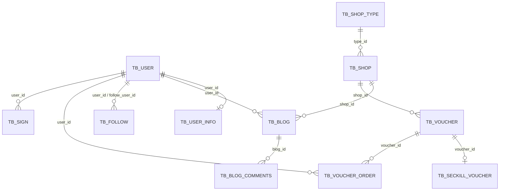

# 城享汇项目：07. MySQL 表设计、索引与主键

## 1. 数据库在项目中的定位

MySQL 保存用户、商户、内容、关注、优惠券、订单和缓存失效事件，是核心业务数据的最终事实源。Redis、Caffeine 和 RabbitMQ 用于加速、削峰和解耦，但订单是否存在、数据库库存是否扣减、商户信息是否更新，最终仍以 MySQL 为准。

当前初始化脚本包含 12 张表：

| 领域 | 表 |
|---|---|
| 用户 | `tb_user`、`tb_user_info`、`tb_sign` |
| 商户 | `tb_shop`、`tb_shop_type` |
| 内容互动 | `tb_blog`、`tb_blog_comments`、`tb_follow` |
| 优惠券和订单 | `tb_voucher`、`tb_seckill_voucher`、`tb_voucher_order` |
| 工程事件 | `tb_cache_invalidate_outbox` |

所有表使用 InnoDB 和 utf8mb4。DDL 没有声明物理外键，表之间通过业务 ID 建立逻辑关系。

## 2. 逻辑表关系



`tb_cache_invalidate_outbox` 不直接使用外键。它用 `cache_name + cache_key` 表示要失效的缓存，例如 `shop + 1`。

> 上图表达逻辑关系，不代表数据库中实际存在 FOREIGN KEY 约束。

## 3. 主键策略总览

| 表 | 主键 | 生成方式 | 设计原因 |
|---|---|---|---|
| `tb_user` | `id bigint unsigned` | MySQL AUTO_INCREMENT | 普通低频写入，创建后才能返回 ID 也可接受 |
| `tb_user_info` | `user_id bigint unsigned` | 复用用户 ID | 与用户形成一对一共享主键 |
| `tb_shop` | `id bigint unsigned` | AUTO_INCREMENT | 商户基础数据写入频率低，聚簇写入顺序稳定 |
| `tb_shop_type` | `id bigint unsigned` | AUTO_INCREMENT | 小型字典表 |
| `tb_blog` | `id bigint unsigned` | AUTO_INCREMENT | 普通内容发布 |
| `tb_blog_comments` | `id bigint unsigned` | AUTO_INCREMENT | 评论实体独立标识；当前业务尚未实现 |
| `tb_follow` | `id bigint` | AUTO_INCREMENT | 关注关系有独立行 ID，但还需要业务唯一索引 |
| `tb_sign` | `id bigint unsigned` | AUTO_INCREMENT | 预留签到明细；当前签到实际使用 Redis Bitmap |
| `tb_voucher` | `id bigint unsigned` | AUTO_INCREMENT | 优惠券主记录 |
| `tb_seckill_voucher` | `voucher_id bigint unsigned` | 复用券 ID | 与 `tb_voucher` 一对一，避免额外代理主键 |
| `tb_voucher_order` | `id bigint` | Snowflake | 在写 MySQL 前就要供 Redis、MQ 和客户端使用 |
| `tb_cache_invalidate_outbox` | `id bigint unsigned` | AUTO_INCREMENT | 事件按插入顺序扫描，便于运维定位 |

## 4. InnoDB 主键为什么重要

InnoDB 以主键组织聚簇索引，行数据存放在主键 B+Tree 叶子节点。二级索引叶子还会携带主键值。因此：

- 主键应尽量短，项目统一使用 bigint，兼顾容量和 Java Long 映射。
- 自增主键通常从索引尾部顺序写入，页分裂较少，适合普通业务表。
- 订单 Snowflake ID 不是数据库自增，但总体随时间趋势递增，比完全随机 UUID 更友好。
- 每个二级索引都会额外保存 bigint 主键，因此无业务价值的索引会占用存储并增加写放大。

### 为什么订单表不用 AUTO_INCREMENT

秒杀链路在访问 Redis Lua 和发送 RabbitMQ 前就必须得到 orderId，用它串联：

```text
Redis reservation
Redis Pending
RabbitMQ CorrelationData / Message ID
MySQL订单主键
客户端状态查询
```

如果依赖数据库自增，就必须先写数据库才能获得 ID，与异步削峰设计冲突。Snowflake 允许在 JVM 内提前生成 ID。

### Snowflake 主键的代价

- 多实例必须分配不同 workerId/datacenterId。
- 时钟回拨需要治理。
- Long 值可能超过 JavaScript 安全整数，应序列化成字符串。
- 趋势递增不等于完全连续，会比自增主键更容易产生少量页间分散，但远好于随机 UUID。

## 5. 用户相关表

### 5.1 `tb_user`

核心字段：

| 字段 | 类型 | 含义 |
|---|---|---|
| `id` | bigint unsigned | 用户主键，自增 |
| `phone` | varchar(11) | 登录手机号 |
| `password` | varchar(128) | 预留密码摘要字段；当前登录代码未使用 |
| `nick_name` | varchar(32) | 昵称 |
| `icon` | varchar(255) | 头像地址 |
| `create_time/update_time` | timestamp | 创建与更新时间 |

现有索引：

```sql
PRIMARY KEY (id)
UNIQUE KEY uniqe_key_phone (phone)
```

手机号登录执行 `WHERE phone = ?`，唯一索引既加速查询，也保证并发注册时一个手机号最多对应一个用户。索引名中的 `uniqe` 是拼写问题，不影响功能，可在迁移中改为 `uk_user_phone`。

当前验证码登录没有使用 password 字段。不能因为表里存在该字段就宣称密码登录已经实现。

### 5.2 `tb_user_info`

保存城市、个人介绍、粉丝数、关注数、性别、生日、积分和会员级别。

```sql
PRIMARY KEY (user_id)
```

`user_id` 同时是业务外键和主键，表示一名用户最多一条扩展资料。这种共享主键的一对一设计不需要再增加独立自增 ID，按用户查询也能直接走聚簇索引。

`fans` 和 `followee` 是冗余计数，用于减少每次展示资料时的聚合查询。冗余提高读取性能，但必须处理关注关系与计数更新的一致性；当前关注事务会同时修改关系和计数，但 Redis Set 仍是事务外资源。

### 5.3 `tb_sign`

表包含 userId、年、月、日期和是否补签，但当前签到实现实际写 Redis Bitmap，没有读写此表。

现有索引只有：

```sql
PRIMARY KEY (id)
```

如果以后启用数据库签到明细，至少应增加：

```sql
UNIQUE KEY uk_sign_user_date (user_id, date)
KEY idx_sign_user_month (user_id, year, month)
```

前者保证一天只能签到一次，后者支持按用户月份查询。当前不应为未启用的表盲目加索引。

## 6. 商户相关表

### 6.1 `tb_shop_type`

商户类型是小型字典表，包含名称、图标和排序值，主键为自增 ID。

当前查询：

```sql
SELECT ... FROM tb_shop_type ORDER BY sort ASC
```

数据量只有少量类型，额外给 sort 建索引收益很低。若类型数量显著增长，可考虑 `KEY idx_shop_type_sort(sort)`；在当前规模下全表排序更简单。

### 6.2 `tb_shop`

核心字段包括：

- `name/type_id`：商户名称与类型。
- `images/area/address/open_hours`：展示信息。
- `x/y`：经纬度。
- `avg_price/sold/comments/score`：价格、销量、评论数和评分。
- `score` 用整数保存放大后的分值，避免浮点误差。

现有索引：

```sql
PRIMARY KEY (id)
KEY foreign_key_type (type_id)
```

`type_id` 索引对应无坐标时的分类分页查询：

```sql
WHERE type_id = ? LIMIT ...
```

附近商户不依赖 MySQL 经纬度索引，而是先用 Redis GEO 获得 shopId，再按主键 `WHERE id IN (...)` 回表。`IN` 中全部是主键，可以高效点查；`ORDER BY FIELD(id, ...)` 用于恢复 GEO 距离顺序，通常会在结果集上额外排序，但页大小只有 10。

名称搜索使用：

```sql
WHERE name LIKE '%keyword%'
```

普通 B+Tree 无法有效支持前导 `%`，因此简单给 name 建普通索引并不能解决模糊搜索。可选优化：

- 业务允许前缀匹配时改为 `LIKE 'keyword%'` 并建索引。
- 使用 MySQL FULLTEXT，但中文分词和排序能力有限。
- 数据量和搜索需求较大时使用 Elasticsearch/OpenSearch。

字段设计注意：`sold/comments` 使用 `int(10) unsigned zerofill`。`10` 是显示宽度，不限制数值位数，ZEROFILL 在新版本 MySQL 中也不推荐；可迁移为普通 `int unsigned`，格式化交给前端。

## 7. 内容与关注表

### 7.1 `tb_blog`

保存所属商户、作者、标题、图片列表、正文、点赞数和评论数。

现有索引只有主键，但当前存在两类高频查询：

```sql
-- 用户主页
WHERE user_id = ? ORDER BY create_time DESC

-- 热门笔记
ORDER BY liked DESC, create_time DESC
```

建议根据数据规模增加：

```sql
KEY idx_blog_user_time (user_id, create_time)
KEY idx_blog_hot (liked, create_time)
```

联合索引遵循最左前缀：`(user_id, create_time)` 同时支持 userId 等值过滤和时间排序。MySQL 可以反向扫描 B+Tree，因此在当前兼容版本中不一定要在 DDL 中声明 DESC。

热门索引是否值得建立要结合写入频率和分页深度。liked 每次点赞都会更新，包含 liked 的索引也要同步维护；如果热榜访问很高，可把排行榜放 Redis ZSet 并异步回写，而不是持续维护大表排序索引。

图片列表目前以逗号分隔放在 varchar 中，读取简单，但无法单独约束和查询。若需要图片排序、审核、元数据或独立删除，应拆成 `tb_blog_image(blog_id, url, sort)`。

### 7.2 `tb_blog_comments`

表支持一级评论和回复：

- `blog_id`：所属笔记。
- `parent_id`：一级评论 ID；一级评论为 0。
- `answer_id`：被回复的具体评论。
- `status`：正常、被举报或禁止查看。

当前评论 Controller 为空，没有实际查询链路，因此只有主键。若实现评论列表，常见索引为：

```sql
KEY idx_comment_blog_parent_time (blog_id, parent_id, create_time)
KEY idx_comment_user_time (user_id, create_time)
```

是否把 status 放进联合索引要看状态分布和查询方式；低基数字段单独建索引通常选择性较差。

### 7.3 `tb_follow`

字段：

```text
user_id        发起关注的用户
follow_user_id 被关注的用户
```

当前查询模式：

```sql
WHERE user_id = ? AND follow_user_id = ?  -- 是否关注、取消关注
WHERE follow_user_id = ?                  -- 查询作者粉丝、推送Feed
WHERE user_id = ?                         -- 关注数
```

DDL 目前只有自增主键，这会导致关系检查、删除和粉丝查询随着表增长退化为全表扫描，也无法在数据库层阻止并发重复关注。

推荐：

```sql
UNIQUE KEY uk_follow_user_target (user_id, follow_user_id)
KEY idx_follow_target_user (follow_user_id, user_id)
```

第一个索引同时实现业务唯一约束，并利用最左前缀支持 `WHERE user_id=?`。第二个反向索引支持查询某人的粉丝。应用层“先查再插”不能替代唯一约束，因为两个并发事务都可能先查到不存在。

## 8. 优惠券与订单表

### 8.1 `tb_voucher`

保存券的公共信息：商户、标题、规则、支付金额、抵扣金额、类型和状态。

金额使用 bigint 保存“分”，避免 decimal/浮点在应用计算和序列化中的误差。例如 8000 表示 80 元。

当前商户券列表查询：

```sql
FROM tb_voucher v
LEFT JOIN tb_seckill_voucher sv ON v.id = sv.voucher_id
WHERE v.shop_id = ? AND v.status = 1
```

`tb_voucher` 目前只有主键，建议增加：

```sql
KEY idx_voucher_shop_status (shop_id, status)
```

它匹配 shopId 等值和 status 等值过滤。`tb_seckill_voucher.voucher_id` 是主键，所以 Join 右表能直接主键查找。

### 8.2 `tb_seckill_voucher`

`voucher_id` 既是主键，也逻辑关联 `tb_voucher.id`，形成一对一扩展：

```text
tb_voucher            券的通用展示和价格信息
tb_seckill_voucher   只有秒杀券才有的库存和活动时间
```

拆表避免普通券携带无意义的秒杀字段，也让库存更新集中在较窄的表中。

库存扣减 SQL 等价于：

```sql
UPDATE tb_seckill_voucher
SET stock = stock - 1
WHERE voucher_id = ? AND stock > 0;
```

voucherId 是主键，先定位唯一行，再检查 stock，不需要给 stock 单独建索引。对单行更新而言，`stock > 0` 是条件更新/乐观控制，保证并发下库存不会扣成负数。

### 8.3 `tb_voucher_order`

主键：

```sql
PRIMARY KEY (id)
```

id 由 Snowflake 生成，不是 AUTO_INCREMENT。

核心业务约束：

```sql
UNIQUE KEY uk_user_voucher (user_id, voucher_id)
```

它有三重作用：

1. 保证同一用户对同一券最多一单。
2. RabbitMQ 重复消息使用不同 orderId 时仍能被拦截。
3. 支持按 `user_id` 查询用户订单，因为符合最左前缀。

主键 id 还保证同一条 MQ 消息重复投递时直接冲突。消费者捕获 `DuplicateKeyException` 后 ACK，实现“至少一次投递 + 数据库幂等”。

当前索引不能高效支持只按 voucherId 查询，因为 `(user_id, voucher_id)` 的第一列不是 voucherId。现有运行链路主要按 orderId 点查，不需要额外索引；压测后的券订单统计如果成为常规接口，可增加：

```sql
KEY idx_order_voucher_time (voucher_id, create_time)
```

若增加用户订单列表并按时间分页，可考虑：

```sql
KEY idx_order_user_time (user_id, create_time)
```

但它与现有 `uk_user_voucher` 都以 userId 开头，会增加写成本，应依据实际 SQL 和 EXPLAIN 决定是否同时保留。

## 9. 缓存失效 Outbox 表

### 9.1 表的用途

`tb_cache_invalidate_outbox` 把“商户更新后必须失效缓存”持久化到 MySQL。商户 UPDATE 和 Outbox INSERT 在同一事务中提交，避免数据库成功但 JVM 在发消息前宕机导致事件永久丢失。

### 9.2 现有索引

```sql
PRIMARY KEY (id)
KEY idx_outbox_due (status, next_retry_time)
```

任务扫描条件：

```sql
WHERE status = 0
  AND next_retry_time <= ?
ORDER BY id
LIMIT ?
```

联合索引先使用 status 等值，再对 nextRetryTime 做范围扫描，能快速跳过未到期事件。`recoverExpiredClaims` 的 `status=1 AND next_retry_time<=?` 也可复用。

需要注意：范围扫描 nextRetryTime 后再 `ORDER BY id`，优化器不一定能同时利用索引完成排序。更一致的方案是将查询改为：

```sql
ORDER BY next_retry_time, id
```

并考虑索引：

```sql
KEY idx_outbox_due (status, next_retry_time, id)
```

InnoDB 二级索引叶子本身已附带主键 id，但显式纳入定义能让意图更清晰。是否调整必须用真实数据量和 `EXPLAIN ANALYZE` 验证；当前小规模 Outbox 使用现有索引已经可工作。

### 9.3 为什么 Outbox 主键用自增

事件只在数据库事务中创建，不需要提前跨系统使用 ID；自增主键简单、写入局部性好，也便于按事件顺序排查。消息 ID 使用 Outbox eventId，重试时仍保持相同业务关联标识。

## 10. 当前实际索引清单

| 表 | 当前索引 | 支撑的主要场景 |
|---|---|---|
| `tb_user` | PK(id)、UK(phone) | 用户点查、手机号登录和唯一性 |
| `tb_user_info` | PK(user_id) | 一对一资料点查 |
| `tb_shop` | PK(id)、KEY(type_id) | 商户详情、分类分页 |
| `tb_shop_type` | PK(id) | 类型点查；表很小 |
| `tb_blog` | PK(id) | 笔记详情；列表查询缺联合索引 |
| `tb_blog_comments` | PK(id) | 当前评论业务未实现 |
| `tb_follow` | PK(id) | 当前关系查询缺业务索引与唯一约束 |
| `tb_sign` | PK(id) | 当前签到实际不使用该表 |
| `tb_voucher` | PK(id) | 券详情；商户券列表缺联合索引 |
| `tb_seckill_voucher` | PK(voucher_id) | 一对一 Join、库存单行条件更新 |
| `tb_voucher_order` | PK(id)、UK(user_id,voucher_id) | 订单点查、消费幂等、一人一单 |
| `tb_cache_invalidate_outbox` | PK(id)、KEY(status,next_retry_time) | 到期事件和租约恢复扫描 |

## 11. 推荐索引优先级

### 第一优先级：直接影响正确性或现有高频查询

```sql
ALTER TABLE tb_follow
  ADD UNIQUE KEY uk_follow_user_target (user_id, follow_user_id),
  ADD KEY idx_follow_target_user (follow_user_id, user_id);

ALTER TABLE tb_voucher
  ADD KEY idx_voucher_shop_status (shop_id, status);

ALTER TABLE tb_blog
  ADD KEY idx_blog_user_time (user_id, create_time);
```

### 第二优先级：视数据规模与接口需求增加

```sql
ALTER TABLE tb_blog
  ADD KEY idx_blog_hot (liked, create_time);

ALTER TABLE tb_voucher_order
  ADD KEY idx_order_voucher_time (voucher_id, create_time);
```

### 当前不建议盲目增加

- `tb_shop.name` 普通索引：无法优化 `%keyword%`。
- `tb_seckill_voucher.stock`：库存更新先按主键定位单行。
- `tb_shop.x/y`：附近查询走 Redis GEO，不走 MySQL 空间搜索。
- 低基数字段 `status/type/gender` 的单列索引：选择性通常较低，应与高选择性列组成联合索引。

所有推荐都应先在接近真实数据量的环境执行 `EXPLAIN`，再结合慢查询决定，不能以“索引越多越好”为目标。

## 12. 联合索引与最左前缀的项目实例

### `uk_user_voucher(user_id, voucher_id)`

可以支持：

```sql
WHERE user_id = ?
WHERE user_id = ? AND voucher_id = ?
```

不能高效支持：

```sql
WHERE voucher_id = ?
```

因为跳过了最左列 userId。

### `idx_outbox_due(status, next_retry_time)`

可以支持：

```sql
WHERE status = ?
WHERE status = ? AND next_retry_time <= ?
```

不适合只按 nextRetryTime 查询，因为缺少最左列 status。

### `idx_blog_user_time(user_id, create_time)`

适合用户主页按时间分页。若查询只有 `ORDER BY create_time` 而没有 userId，不能完整利用该联合索引。

## 13. 为什么没有数据库外键

当前 DDL 只保留逻辑关联，没有 FOREIGN KEY。可能的工程考虑包括：

- 避免高并发写入时额外的父表检查和锁影响。
- 简化数据导入、压测重置和未来分库分表。
- 删除、补偿和消息处理由应用显式控制。

代价是数据库不会自动阻止孤儿记录，例如不存在的 userId 或 voucherId。需要通过：

- 应用校验。
- 事务边界。
- 唯一约束和非空约束。
- 定期数据对账。
- 管理接口权限控制。

来维持引用完整性。对中小型单库系统，使用外键也完全合理；这里应表述为当前项目的取舍，而不是“外键一定不好”。

## 14. 事务与表之间的配合

### 14.1 秒杀订单事务

```text
INSERT tb_voucher_order
UPDATE tb_seckill_voucher SET stock=stock-1 WHERE stock>0
```

同一事务提交或回滚。订单表唯一索引负责幂等，库存条件更新负责防超卖。

### 14.2 商户更新事务

```text
UPDATE tb_shop
INSERT tb_cache_invalidate_outbox
```

同一事务提交，保证数据库一旦更新成功，就一定留下可恢复的缓存失效意图。

### 14.3 关注事务

关注关系和 userInfo 中的粉丝/关注计数在同一 MySQL 事务中修改。Redis Set 不属于 MySQL 事务，因此仍可能短暂不一致；推荐增加关系唯一索引，并用 Outbox 或定期重建处理跨组件一致性。

### 14.4 新增秒杀券

`tb_voucher` 与 `tb_seckill_voucher` 在数据库事务中写入，但 Redis 库存和活动时间初始化不是 MySQL 事务资源。若 Redis 部分写入后发生异常，可能需要清理或重新初始化；生产设计可通过事务提交后事件、Outbox 或幂等初始化任务完成。

## 15. 字段设计评价

### 合理设计

- 金额以分为单位使用整数，避免浮点误差。
- 评分放大后用整数保存。
- 创建和更新时间由数据库提供默认值。
- 订单表用唯一索引表达核心业务不变量。
- 一对一扩展表复用主键，避免冗余 ID。
- Outbox 明确保存状态、阶段、重试次数、下次执行时间和错误摘要。

### 可改进设计

- 个别关联字段 signed/unsigned 不完全一致，例如 blog.shopId 与 shop.id，应统一类型。
- 字段级 collation 同时出现 `utf8mb4_general_ci` 和 `utf8mb4_unicode_ci`，可统一，避免 Join/比较时转换或排序规则差异。
- 图片列表使用逗号分隔，不利于单项管理。
- `tb_follow` 缺业务唯一索引和反向查询索引。
- `tb_voucher` 缺商户状态联合索引。
- `tb_blog` 缺用户时间联合索引。
- `tb_sign` 与实际 Redis Bitmap 实现并存但未使用，需要明确是审计明细预留还是删除。
- DDL 使用 `int(N) zerofill` 等旧式显示定义，迁移 MySQL 8 时应清理。

## 16. 如何用 EXPLAIN 验证

索引建议不能只凭字段名判断。可以对实际 SQL 执行：

```sql
EXPLAIN SELECT *
FROM tb_follow
WHERE user_id = 1010 AND follow_user_id = 2;

EXPLAIN SELECT *
FROM tb_blog
WHERE user_id = 1010
ORDER BY create_time DESC
LIMIT 10;

EXPLAIN SELECT v.*, sv.stock, sv.begin_time, sv.end_time
FROM tb_voucher v
LEFT JOIN tb_seckill_voucher sv ON v.id = sv.voucher_id
WHERE v.shop_id = 1 AND v.status = 1;

EXPLAIN SELECT id
FROM tb_cache_invalidate_outbox
WHERE status = 0 AND next_retry_time <= NOW()
ORDER BY id
LIMIT 50;
```

重点观察：

- `type` 是否为 const/ref/range，而不是 ALL。
- `key` 是否命中预期索引。
- `rows` 估算扫描行数。
- `Extra` 是否出现 `Using filesort`、`Using temporary`。
- 联合索引是否因为跳过最左列而失效。

MySQL 8 可使用 `EXPLAIN ANALYZE` 对比估算和真实执行时间；项目当前驱动和文档兼容 MySQL 5.7，因此不能假设所有环境都支持。

## 17. 面试回答模板

### 项目主键怎么设计？

> 普通业务表使用 bigint 自增主键，保证 InnoDB 聚簇索引顺序写入；一对一扩展表如 userInfo 和 seckillVoucher 复用主表 ID。秒杀订单使用 Snowflake，因为在写数据库前就要把 orderId 用于 Redis Pending、MQ 消息和客户端状态查询。订单 ID 趋势递增，也比随机 UUID 更适合作为聚簇主键。

### 哪个索引最重要？

> `tb_voucher_order` 的 `(user_id, voucher_id)` 唯一索引最关键。它不是单纯的性能索引，而是把“一人一单”这个业务不变量交给数据库兜底，同时处理 MQ 重复消费。主键拦截相同消息，联合唯一索引还能拦截不同 orderId 的同用户同券重复订单。

### 当前最需要补的索引是什么？

> 第一是关注表的 `(user_id, follow_user_id)` 唯一索引和 `follow_user_id` 反向索引，既保证并发关注唯一性，也支持粉丝查询；第二是券表的 `(shop_id, status)`，匹配商户可用券列表；第三是笔记表的 `(user_id, create_time)`，匹配用户主页分页。最终要用真实数据和 EXPLAIN 验证。

### 为什么不在所有关联字段上都建索引？

> 索引会占空间并增加 INSERT/UPDATE 的维护成本。要从真实查询的 WHERE、JOIN、ORDER BY 和数据选择性出发。例如附近商户已经走 Redis GEO，给经纬度普通建索引没有价值；名称是前导百分号模糊查询，普通 B+Tree 也难以命中。

### 为什么不用外键？

> 当前项目把引用完整性交给应用和对账，减少压测重置、异步补偿和未来拆分时的约束。代价是可能产生孤儿数据，所以唯一约束、非空约束、事务和对账必须做扎实。这是一项取舍，不代表外键本身不好。
