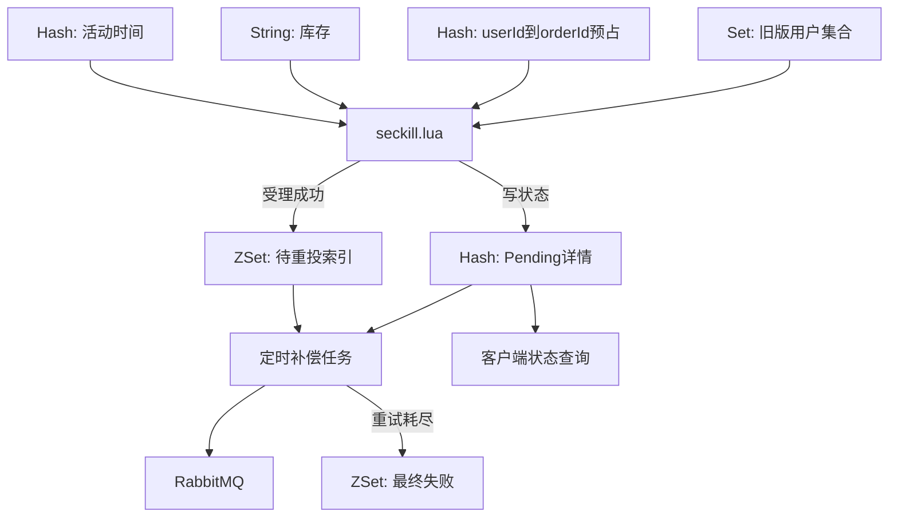

# 城享汇项目：08. Redis 数据结构与 Key 设计

## 1. Redis 在项目中的职责

项目没有把 Redis 只当作普通缓存，而是同时用于：

- 登录验证码和 Token 会话。
- 商户、商户类型等读缓存。
- 附近商户的地理位置索引。
- 用户签到 Bitmap。
- 点赞排行榜、关注关系和关注流。
- 秒杀库存、活动时间、一人一单预占和订单补偿状态。
- 分布式滑动窗口限流。
- 非核心订单统计。
- 预留的简单分布式锁工具。

选择数据结构的原则是让业务操作直接映射为 Redis 原生命令，例如“唯一关系”对应 Set、“按时间排序”对应 ZSet、“连续布尔状态”对应 Bitmap、“局部更新对象字段”对应 Hash。

## 2. 当前主链路 Key 总览

| Key 模式 | 结构 | Value/成员 | TTL | 主要用途 |
|---|---|---|---|---|
| `login:code:{phone}` | String | 6 位验证码 | 2 分钟 | 验证码登录 |
| `login:token:{token}` | Hash | UserDTO 字段 | 有，但当前单位配置不一致 | 分布式登录会话 |
| `cache:shop:{shopId}` | String | Shop JSON 或空字符串 | 正常值 30～40 分钟；空值 2 分钟 | 商户详情缓存、防穿透 |
| `cache:shop-type:list` | String | 商户类型列表 JSON | 当前无 TTL | 类型列表缓存 |
| `shop:geo:{typeId}` | GEO | member=shopId，经纬度坐标 | 当前无 TTL | 附近商户 |
| `sign:{userId}:{yyyy-MM}` | Bitmap/String | 每天一个 bit | 当前无 TTL | 签到及连续签到 |
| `blog:liked:{blogId}` | ZSet | member=userId，score=点赞时间 | 当前无 TTL | 点赞状态与前五点赞用户 |
| `follows:{userId}` | Set | followUserId | 当前无 TTL | 关注关系、共同关注 |
| `feed:{userId}` | ZSet | member=blogId，score=发布时间 | 当前无 TTL | 关注流滚动分页 |
| `rate:limit:{business}:{scope}:{value}` | ZSet | member=requestId，score=请求时间 | 窗口秒数 + 1 | 滑动窗口限流 |
| `seckill:stock:{voucherId}` | String | 可售库存整数 | 当前无 TTL | 秒杀库存预扣 |
| `seckill:time:{voucherId}` | Hash | begin/end 毫秒时间 | 当前无 TTL | 秒杀活动时间校验 |
| `seckill:reservation:{voucherId}` | Hash | field=userId，value=orderId | 当前无 TTL | 新版一人一单预占 |
| `seckill:order:{voucherId}` | Set | userId | 当前无 TTL | 兼容旧版一人一单数据 |
| `seckill:pending:{voucherId}` | ZSet | member=orderId，score=下次重试时间 | 当前无 TTL | 投递失败订单扫描 |
| `seckill:pending:data:{voucherId}:{orderId}` | Hash | 订单投递状态及耗时 | 24 小时 | 补偿与状态查询 |
| `seckill:pending:failed:{voucherId}` | ZSet | member=orderId，score=失败时间 | 当前无 TTL | 最终失败订单索引 |
| `seckill:analytics:order:created:{yyyyMMdd}` | String | 成功订单计数 | 3 天 | 非核心实时统计 |

表中的 `{voucherId}` 是 Redis Cluster Hash Tag，不是文档占位符的普通花括号。相同券的多个 Key 会被路由到同一个 slot。

## 3. String：简单值、JSON 和计数器

Redis String 不只保存文本，也适合整数、序列化 JSON 和 Bitmap。项目用它保存验证码、商户 JSON、秒杀库存和统计计数。

### 3.1 登录验证码

```text
Key:   login:code:13800000000
Type:  String
Value: 6位数字验证码
TTL:   2分钟
```

选择 String 的原因：

- 一个手机号同一时刻只需要一个有效验证码。
- 登录校验只需一次 GET 和字符串比较。
- SET 时直接附带 TTL，验证码会自动过期。

当前发送短信只是日志模拟，登录成功后也没有立即删除验证码。生产系统应在校验成功后删除，并限制发送与校验次数。

### 3.2 商户详情缓存

```text
Key:   cache:shop:1
Type:  String
Value: Shop JSON，或者空字符串
TTL:   正常值30～40分钟；空值2分钟
```

选择 String JSON 的原因：

- 查询总是读取完整商户对象，不需要频繁局部修改字段。
- 一次 GET 即可获得完整对象，序列化和反序列化逻辑简单。
- 与 Caffeine 中缓存完整 Shop 对象的模型一致。

空字符串有特殊语义：数据库已经确认商户不存在。再次请求时直接返回不存在，避免同一个非法 ID 反复穿透 MySQL。

正常缓存使用 30 分钟基础 TTL 加 0～10 分钟随机抖动，减少大量 Key 同时失效导致的缓存雪崩。

### 3.3 商户类型列表

```text
Key:   cache:shop-type:list
Type:  String
Value: List<ShopType> JSON
TTL:   当前未设置
```

类型列表数据量小，每次通常整体展示，所以序列化成一个 JSON String 比拆成多个 Hash 或 List 更直接。

当前问题是没有 TTL 和更新失效逻辑。若后台修改类型，Redis 可能长期保留旧值。可以增加 TTL，或者复用商户 Outbox 思路发送类型缓存失效事件。

### 3.4 秒杀库存

```text
Key:   seckill:stock:{11}
Type:  String
Value: 整数库存
```

选择 String 整数的原因：

- Lua 可以直接 GET、tonumber 和 INCRBY -1。
- 恢复库存时可用 INCRBY +1。
- Redis 单线程和 Lua 原子执行能避免并发读改写超卖。

Redis 库存是秒杀受理层库存，MySQL `tb_seckill_voucher.stock` 是最终账本，两者通过 MQ 落库和失败补偿最终收敛。

### 3.5 日订单计数

```text
Key:   seckill:analytics:order:created:20260927
Type:  String整数
Value: 当日成功创建订单数
TTL:   3天
```

事务提交后的异步任务执行 INCR。选择 String 计数器是因为 INCR 原子、成本低，不需要先 GET 再 SET。

这只是短期实时统计，不是长期报表事实源；线程池或 Redis 故障可能造成统计遗漏，订单表才是准确来源。

## 4. Hash：对象字段与映射关系

Hash 适合一个 Key 下包含多个字段，或者保存 field→value 映射。项目用于登录用户摘要、活动时间、用户订单预占和 Pending 状态。

### 4.1 Token 会话

```text
Key:    login:token:{token}
Type:   Hash
Fields: id、nickName、icon
```

选择 Hash 的原因：

- 登录拦截器一次 HGETALL 可还原 UserDTO。
- 修改昵称或头像时可 HSET 单个字段，无需反序列化整个 JSON。
- Token 本身随机且不可推测，Redis 负责跨实例共享会话。

请求进入后，刷新拦截器把 Hash 转成 UserDTO 放入 ThreadLocal，并刷新过期时间；登出时 DEL 整个 Key。

### 当前 TTL 问题

常量值是 `36000`，但不同位置使用了不同时间单位：

- 登录创建和资料更新时使用 DAYS。
- 普通请求刷新时使用 MINUTES。

这会导致首次创建 TTL 极长，第一次访问后又变成 36000 分钟。应把配置改成明确的 `Duration`，例如统一为 30 分钟或按业务要求设置，避免数字与单位分离。

### 4.2 秒杀活动时间

```text
Key:    seckill:time:{11}
Type:   Hash
Fields: beginTimeMillis、endTimeMillis
```

选择 Hash 的原因：开始和结束时间属于同一活动对象，但 Lua 只需要读取两个独立字段。HGET 比解析整个 JSON 更直接，也便于单独修复字段。

Lua 使用 Redis TIME 获取当前时间，在一个脚本内完成时间校验和库存预扣。

### 4.3 一人一单 reservation

```text
Key:    seckill:reservation:{11}
Type:   Hash
Field:  userId
Value:  orderId
```

选择 Hash 而不是普通 Set，是因为不仅需要知道“用户是否参与过”，还要知道该用户对应哪个 orderId：

- HGET userId 可以检测重复请求。
- 返回已有 orderId，为请求幂等提供基础。
- 失败恢复时比较 `reservation[userId] == orderId`，防止旧订单补偿误删新预占。

相比 `Set<userId>`，Hash 多保存了 orderId，但换来了可追踪性和更安全的补偿所有权判断。

### 4.4 Pending 订单详情

```text
Key:  seckill:pending:data:{11}:2090000000000000000
Type: Hash
TTL:  24小时
```

主要字段：

| 字段 | 含义 |
|---|---|
| `orderId/userId/voucherId` | 订单身份信息 |
| `status` | PENDING、SENT、BROKER_NACK、ROUTE_FAILED、REPUBLISHING、CONSUMING、ORDER_CREATED、FAILED等 |
| `retryCount` | 定时重投次数 |
| `createTime` | Lua受理时间 |
| `sentTime` | Broker确认时间 |
| `consumeStartTime` | 消费开始时间 |
| `dbCommittedTime` | 数据库事务完成时间 |
| `retryDelayMillis/nextRetryTime` | 下次补偿调度 |
| `lastError` | 最近失败原因 |
| `queueDelayMillis` | Redis受理到消费开始 |
| `dbProcessMillis` | 消费开始到数据库完成 |
| `endToEndMillis` | Redis受理到数据库完成 |

选择 Hash 的原因：

- 状态机会频繁更新少数字段。
- HINCRBY 可原子增加 retryCount。
- 状态接口可以 HGETALL 还原完整处理状态。
- 比每次读写整个 JSON 更适合局部更新。

24 小时 TTL 限制观测数据长期增长。订单永久事实仍在 MySQL。

## 5. Set：唯一集合与交集

### 5.1 关注集合

```text
Key:    follows:{userId}
Type:   Set
Member: followUserId
```

选择 Set 的原因：

- 同一个 member 天然唯一。
- 关注用 SADD，取消关注用 SREM。
- 两个用户的共同关注可直接使用 SINTER。

MySQL `tb_follow` 才是持久关系，Redis Set 是共同关注等场景的加速结构。当前 MySQL 表缺少 `(user_id, follow_user_id)` 唯一索引，Redis Set 的唯一性不能替代数据库约束，因为 Redis 和 MySQL 可能短暂不一致。

当前 Key 没有 TTL，用户长期活跃时合理，但取消关注或数据库修复失败可能产生脏成员。可通过关系变更事件、定期重建或对账保证一致性。

### 5.2 旧版本秒杀用户集合

```text
Key:    seckill:order:{voucherId}
Type:   Set
Member: userId
```

这是旧版本一人一单结构，只能判断 SISMEMBER，不能找到原 orderId。当前 Lua 仍读取它用于升级兼容，避免切换到 reservation Hash 后，旧数据用户再次下单。

新业务主结构已经是 `seckill:reservation:{voucherId}` Hash。该 Set 不应作为当前方案的首选设计来介绍。

## 6. ZSet：排序、时间线和到期调度

ZSet 同时提供成员唯一性和按 score 排序，项目用它处理排行榜、Feed、滑动窗口与补偿调度。

### 6.1 笔记点赞用户

```text
Key:    blog:liked:{blogId}
Type:   ZSet
Member: userId
Score:  点赞时间戳
```

选择 ZSet 而不是 Set，是因为除了判断用户是否点赞，还要按点赞时间取前五位用户：

- ZSCORE 判断是否存在。
- ZADD 写入点赞时间。
- ZREM 取消点赞。
- ZRANGE 取最早点赞的前五位。

当前代码取的是 score 从小到大的前五名，即最早点赞用户，不是最近点赞用户。如果产品要显示最近点赞，应使用 ZREVRANGE。

MySQL blog.liked 保存总点赞数，Redis ZSet 保存点赞用户和顺序。两边不是同一个事务，生产上可用 Outbox/MQ 对账。

### 6.2 关注流 Feed

```text
Key:    feed:{userId}
Type:   ZSet
Member: blogId
Score:  发布时间戳
```

作者发布笔记后，系统把 blogId 推送到每个粉丝的 Feed ZSet。读取时按 score 倒序执行范围查询，并用 `lastId + offset` 实现滚动分页。

选择 ZSet 的原因：

- 天然按发布时间排序。
- 可按 score 范围读取，不依赖数据库深分页 offset。
- 相同时间戳可以通过 offset 避免重复或漏读。

这是写扩散模型，粉丝规模小时读取很快；大 V 会带来大量 ZADD，可改为推拉结合。当前 Feed 没有裁剪和 TTL，长期运行会持续增长，应限制每个用户保留的最新条数或设置归档策略。

### 6.3 滑动窗口限流

```text
Key:    rate:limit:seckill:11:global:global
Type:   ZSet
Member: scopeValue:timestamp:random
Score:  请求时间戳毫秒
TTL:    windowSeconds + 1
```

Lua 原子执行：

```text
删除窗口外记录
统计窗口内成员数
达到阈值则拒绝
未达到则写入当前请求
刷新Key TTL
```

选择 ZSet 是为了精确表示滑动时间窗口。普通 String 计数器更省内存，但更接近固定窗口，边界可能产生突刺。

为每个请求生成唯一 member，避免同一毫秒请求互相覆盖。TTL 防止业务 Key 长期无人访问后仍占内存。

当前时间戳来自应用服务器的 `System.currentTimeMillis()`。多实例时若机器时钟漂移，会影响共享窗口；可像秒杀活动脚本一样改用 Redis TIME。

### 6.4 待重投订单索引

```text
Key:    seckill:pending:{voucherId}
Type:   ZSet
Member: orderId
Score:  下次允许重投的毫秒时间
```

选择 ZSet 是因为补偿任务需要快速查询“现在已经到期”的前 N 条记录：

```text
ZRANGEBYSCORE key 0 now LIMIT 0 100
```

如果使用 List，只能按插入顺序消费，订单重新退避时不好调整执行时间；使用 Set 又无法按到期时间筛选。ZSet 适合实现轻量延迟任务索引。

Confirm ACK 后从 ZSet 移除；NACK、Return 或重投异常会用新的 nextRetryTime 再写入。订单详情保存在单独 Hash 中，避免 ZSet member 塞入复杂 JSON。

### 6.5 最终失败订单索引

```text
Key:    seckill:pending:failed:{voucherId}
Type:   ZSet
Member: orderId
Score:  失败时间
```

ZSet 方便按失败时间查看和批量排查。完整错误原因仍保存在 Pending Hash 的 lastError 字段。

当前 failed ZSet 没有 TTL 或归档清理，会长期增长。生产上应在告警与人工处理完成后迁移到数据库审计表或定期清理。

## 7. Bitmap：签到状态压缩

```text
Key:    sign:{userId}:{yyyy-MM}
Type:   Redis String上的Bitmap
Offset: dayOfMonth - 1
Value:  0/1
```

一个用户一个月最多 31 位，理论有效数据不到 4 字节。签到执行：

```text
SETBIT key day-1 1
```

连续签到统计用 BITFIELD 取本月第一天到今天的位，再从最低位开始进行 `num & 1` 和右移，直到遇到 0。

选择 Bitmap 的原因：

- 状态本质是每天一个布尔值。
- 空间远小于每天一个 String、Set 成员或数据库行。
- 一次 BITFIELD 就能得到本月至今的状态。

Bitmap 不能保存签到时间、地点、奖励和补签详情。如需审计，需要同时写数据库明细或发送事件。

当前签到 Key 没有 TTL。可以在创建月份 Key 时设置到业务要求的保留期，例如 12～24 个月，而不是永久保存。

## 8. GEO：附近商户空间索引

```text
Key:        shop:geo:{typeId}
Type:       GEO（底层基于ZSet）
Member:     shopId
Coordinate: longitude, latitude
```

按商户类型拆 Key，查询时指定用户坐标，在 5 公里内按距离升序取前 `current * pageSize` 条，并返回 distance。随后应用根据 shopId 批量查询 MySQL 完整商户对象。

选择 GEO 的原因：

- Redis 原生支持经纬度写入、半径/距离检索和排序。
- 先按类型拆分可以减少空间搜索候选集。
- 比应用层加载全部坐标后逐个计算距离更高效。

Redis GEO 只保存空间索引，不保存完整商户信息；MySQL 仍是商户详情事实源。

当前 GEO Key 没有 TTL，通常作为持久派生索引存在。但商户新增、坐标变更、类型变更或删除时必须同步维护。当前项目主要通过数据准备测试初始化，缺少完整的在线增量更新链路，这是可改进点。

## 9. 秒杀 Key 为什么统一使用 Hash Tag

例如 voucherId=11：

```text
seckill:stock:{11}
seckill:time:{11}
seckill:reservation:{11}
seckill:order:{11}
seckill:pending:{11}
seckill:pending:data:{11}:2090000000000000000
```

Redis Cluster 默认根据完整 Key 计算 slot；Lua 同时操作多个 Key 时要求它们位于同一 slot。花括号中的 `{11}` 是 Hash Tag，Redis 只用这部分计算 slot，因此同一券的 Key 能在一段 Lua 中原子操作。

不能把所有业务都固定到同一个 Hash Tag，否则会形成单 slot 热点。当前按 voucherId 分片，使不同券可分布到不同 slot。

## 10. 秒杀数据结构如何协作



拆成多个结构的原因：

- 库存需要高效整数增减，所以用 String。
- 活动时间和用户→订单映射需要字段访问，所以用 Hash。
- 到期任务需要按时间排序，所以用 ZSet。
- 详情状态需要局部更新和查询，所以用单订单 Hash。
- 旧版本只保存用户集合，所以保留 Set 做兼容。

## 11. TTL 与生命周期管理

### 已设置 TTL

| Key | TTL 原因 |
|---|---|
| 验证码 | 安全凭证必须短期失效 |
| Token | 会话需要过期和续期 |
| 商户详情 | 允许缓存自动重建，限制旧值窗口 |
| 商户空值 | 防穿透但避免新数据长期不可见 |
| 限流 ZSet | 无后续请求时自动释放窗口记录 |
| Pending Hash | 只需短期补偿与状态观察 |
| 日订单计数 | 只做近三天实时统计 |

### 当前没有 TTL 的 Key

```text
cache:shop-type:list
shop:geo:*
sign:*
blog:liked:*
follows:*
feed:*
seckill:stock:*
seckill:time:*
seckill:reservation:*
seckill:order:*
seckill:pending:*
seckill:pending:failed:*
```

并非所有无 TTL 都错误：GEO、关注关系等可以作为长期派生索引。但必须有更新、删除或重建机制。秒杀数据可根据活动结束时间设置较长缓冲 TTL；Feed、点赞和失败索引应有裁剪或归档策略；签到可按数据保留周期过期。

## 12. 一致性来源与恢复方式

| Redis 数据 | 事实源 | 当前一致性方式 |
|---|---|---|
| 登录会话 | Redis 本身 | TTL、续期和登出删除 |
| 商户缓存 | MySQL `tb_shop` | Outbox删除、MQ广播、延迟双删、TTL |
| 商户类型缓存 | MySQL `tb_shop_type` | 当前仅首次回填，失效机制待补 |
| GEO | MySQL商户坐标 | 数据准备初始化；在线同步待补 |
| 关注 Set | MySQL `tb_follow` | 业务写入时同步更新；缺少补偿对账 |
| 点赞 ZSet | MySQL点赞计数与业务行为 | 业务同步更新；跨组件事务待完善 |
| Feed ZSet | MySQL Blog/Follow | 发布时写扩散；可从业务表重建 |
| 秒杀库存与预占 | MySQL券和订单是最终账本 | Lua、MQ、Pending重投、失败恢复 |
| 限流窗口 | Redis临时状态 | TTL 自动清理，不需要落库 |
| 日统计 | MySQL订单可重算 | 事务后异步 INCR，TTL 3天 |

## 13. 当前有效 Key 与遗留/预留 Key

### 当前主链路正在使用

前文总览表中的登录、缓存、GEO、签到、互动、限流、秒杀和统计 Key 都有当前运行代码读写。

### 遗留兼容

`seckill:order:{voucherId}` 是旧版一人一单 Set。新版本主要使用 reservation Hash，但 Lua 仍读取旧 Set，防止升级后旧用户重新下单；恢复脚本也保留兼容逻辑。

### 工具存在但当前主链路未使用

```text
lock:{name}
lock:shop:{shopId}
```

项目保留 `SimpleRedisLock`、解锁 Lua、CacheClient 逻辑过期和互斥锁工具；ShopService 中旧的互斥锁/逻辑过期实现也保留为注释。当前商户详情实际使用 Caffeine → Redis → MySQL，不会在主链路创建这些锁 Key。

因此面试时可以介绍曾实现或保留了分布式锁工具，但不能说当前二级缓存依赖 Redis 锁防击穿。

## 14. 数据结构选择对比

| 业务问题 | 采用结构 | 为什么不选其他结构 |
|---|---|---|
| 单值验证码 | String | Hash没有必要，Set不表达单值 |
| 完整商户对象 | String JSON | 每次整体读，Hash局部字段优势不明显 |
| Token用户摘要 | Hash | 需要局部更新昵称和头像 |
| 关注关系 | Set | 需要唯一性和集合交集 |
| 点赞排行 | ZSet | Set不能按点赞时间排序 |
| Feed时间线 | ZSet | List不便按时间游标范围查询 |
| 连续签到 | Bitmap | 每日一条String/数据库行空间更大 |
| 附近商户 | GEO | 普通ZSet不能直接完成经纬度距离计算 |
| 秒杀库存 | String整数 | INCRBY简单且适合Lua原子运算 |
| 用户到订单预占 | Hash | Set无法保存对应orderId |
| 延迟重投 | ZSet | List/Set不能高效按到期时间筛选 |
| 限流窗口 | ZSet | 需要保存每次请求时间并动态移除旧记录 |

## 15. 内存与热点风险

### 大 Key

- 粉丝多的用户，其 `follows:{userId}` 可能变大。
- 高互动笔记的 `blog:liked:{blogId}` 可能变大。
- 大量关注者的 Feed 写扩散会产生很多 Key 和成员。
- 长期不清理的 failed ZSet 会持续增长。

治理方式包括按成员数量裁剪、按时间归档、拆分 Key、异步清理以及监控 `MEMORY USAGE`。

### 热 Key

- 热门商户通过 Caffeine 分担 Redis 压力。
- 热门秒杀券的 stock/reservation/限流 Key 会集中在一个 Redis slot。
- 单券极高 QPS 时，即使 Redis Cluster 也不能把同一 Hash Tag 的操作拆到多个 slot，因为 Lua 原子性要求同 slot。

可通过入口限流、活动分片、库存分桶或多级队列缓解，但分桶会增加总库存一致性设计复杂度。

### Key 扫描

生产代码不应使用 KEYS 扫描大空间。当前 Pending 任务按已知 voucherId 直接访问具体 ZSet；虽然存在 `pendingDataPattern` 方法，但主链路没有用它执行全量 KEYS。

## 16. Key 命名规范评价

当前命名大体采用：

```text
业务域:对象:标识
```

例如：

```text
login:token:{token}
cache:shop:{shopId}
blog:liked:{blogId}
seckill:pending:data:{voucherId}:{orderId}
```

优点是可读、便于按业务排查。可继续统一：

- 把代码中的字面量 `follows:`、`feed:`、`blog:liked:` 全部收敛到常量类。
- 为不同环境增加应用前缀，例如 `prod:hmdp:`，避免共用 Redis 时 Key 冲突。
- 明确版本，例如重大结构迁移使用 `seckill:v2:reservation:`。
- 为所有长期派生索引记录生命周期和重建方式。

## 17. 常用排查命令示例

以下只用于测试环境排查，生产环境应使用安全封装和受控账号：

```text
TYPE cache:shop:1
TTL cache:shop:1
GET cache:shop:1

HGETALL login:token:{token}
TTL login:token:{token}

GEODIST shop:geo:1 1 2 km

GETBIT sign:1010:2026-09 26

ZRANGE blog:liked:24 0 4 WITHSCORES
SINTER follows:1010 follows:1012
ZREVRANGEBYSCORE feed:1010 +inf -inf WITHSCORES LIMIT 0 10

GET seckill:stock:{11}
HGETALL seckill:time:{11}
HGET seckill:reservation:{11} 1010
ZRANGEBYSCORE seckill:pending:{11} 0 +inf WITHSCORES
HGETALL seckill:pending:data:{11}:{orderId}
```

不要在生产大库中直接执行 `KEYS *`。

## 18. 面试回答模板

### 项目在 Redis 中保存了哪些数据？

> 我把 Redis 的用途分成五类。第一类是登录数据，验证码用带短 TTL 的 String，Token会话用 Hash；第二类是缓存，商户和商户类型用 JSON String，商户空值防穿透；第三类是本地生活业务结构，附近商户用 GEO、签到用 Bitmap、关注关系用 Set、点赞排行和 Feed 用 ZSet；第四类是秒杀状态，库存用 String，活动时间和用户到订单的 reservation 用 Hash，Pending 调度用 ZSet，订单处理详情用 Hash；第五类是治理数据，滑动窗口限流用 ZSet，订单统计用 String计数器。

### 为什么秒杀用了这么多种结构？

> 因为每种结构对应不同操作：库存需要原子增减，所以是 String；一人一单不仅要判重，还要找到原 orderId，所以用 Hash；失败订单要按下一次重试时间扫描，所以用 ZSet；详细状态需要频繁局部更新，所以每个订单一个 Hash。它们使用相同 voucherId Hash Tag，保证 Redis Cluster 下仍能由 Lua 原子操作。

### Redis 数据丢了怎么办？

> 要按数据类别回答。商户、GEO、关注和 Feed 等是 MySQL 的派生数据，可以回源或重建；限流窗口和短期统计本身就是临时状态；登录会话丢失会导致重新登录；秒杀库存和 reservation 在活动期间最敏感，不能简单从缓存读取逻辑处理，需要暂停入口并根据 MySQL券、订单和 Pending 对账后重建。

### 项目 Redis 设计还有什么不足？

> 部分长期 Key 没有 TTL或裁剪策略，例如 Feed、点赞、签到和失败订单索引；商户类型与 GEO 的在线失效更新链路不完整；Token TTL单位存在不一致；关注和点赞的 MySQL/Redis 跨组件一致性还可以用 Outbox补强。这些都是后续治理重点。
