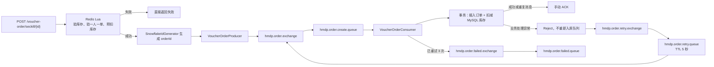

# 黑马点评 RabbitMQ 秒杀订单搭建与复现手册

> 本文以当前 `hm-dianping` 项目的实际实现为准，目标是在同一套基础项目中从零复现现有 RabbitMQ 秒杀下单链路。文中的“当前实现”表示代码已经具备；“增强建议”表示当前代码尚未实现，不能当作现有能力。

## 1. 最终要实现的功能

用户调用秒杀接口后，请求线程不直接写 MySQL，而是完成以下工作：

1. Redis Lua 原子判断库存和“一人一单”，并预扣 Redis 库存。
2. 使用雪花算法生成全局订单 ID。
3. 将 `orderId + userId + voucherId` 发送到 RabbitMQ。
4. 接口立即返回订单 ID。
5. RabbitMQ 消费者异步创建数据库订单并扣减 MySQL 库存。
6. 数据库事务成功后，消费者才手动 ACK。
7. 处理失败时，消息进入延迟重试链路，5 秒后再次消费。
8. 重试 3 次仍失败时，消息进入最终失败队列。
9. RabbitMQ 的至少一次投递可能产生重复消息，依靠订单主键和 `(user_id, voucher_id)` 唯一索引实现最终幂等。

完整链路如下：



## 2. 各层分别承担什么职责

| 部分 | 作用 | 它不能替代什么 |
| --- | --- | --- |
| Redis Lua | 在 Redis 内原子完成资格检查、预扣库存和用户占位，挡住高并发超卖与重复请求 | 不能保证 MySQL 一定成功落单 |
| RabbitMQ | 削峰、异步解耦、保存等待处理的订单消息 | 不能天然保证业务只执行一次 |
| Publisher Confirm | 判断消息是否到达 RabbitMQ Broker | 不能证明消息已经路由到队列或完成消费 |
| Publisher Return | `mandatory=true` 时发现消息无法路由到任何队列 | 不能证明消费者处理成功 |
| 消息持久化 + 持久化交换机/队列 | 提高 Broker 重启后的消息保留能力 | 不能替代生产者失败补偿和集群高可用 |
| 手动 ACK | 只有数据库事务成功后才删除主队列中的消息 | 不能阻止消息重复投递 |
| 数据库唯一索引 | 把重复消费转化为可识别的 `DuplicateKeyException`，实现幂等 | 不能替代 Redis 入口处的一人一单判断 |
| 主队列 DLX + 重试队列 TTL | 失败后等待 5 秒再重试，避免原地高速死循环 | 不能修复永久性业务错误 |
| 最终失败队列 | 隔离超过重试上限的异常订单，供人工或补偿任务处理 | 当前项目没有自动补偿失败队列 |

## 3. 环境和目录约定

当前项目版本：

- Java 8
- Spring Boot 2.7.3
- Spring AMQP
- MySQL 5.x 驱动
- Redis
- RabbitMQ Management 镜像

本文代码采用以下目录：

```text
src/main/java/com/hmdp/
├─ config/RabbitMqConfig.java
├─ controller/VoucherOrderController.java
├─ mq/
│  ├─ RabbitMqConstants.java
│  ├─ VoucherOrderMessage.java
│  ├─ VoucherOrderProducer.java
│  └─ VoucherOrderConsumer.java
├─ service/IVoucherOrderService.java
├─ service/impl/
   ├─ VoucherOrderServiceImpl.java
   └─ VoucherServiceImpl.java
└─ utils/SnowflakeIdGenerator.java

src/main/resources/
├─ application.yaml
├─ docker-compose.yml
├─ seckill.lua
└─ db/hmdp.sql
```

## 4. 第一步：加入 Spring AMQP 依赖

在 `pom.xml` 的 `<dependencies>` 中加入：

```xml
<!-- RabbitMQ + Spring AMQP + RabbitTemplate + @RabbitListener -->
<dependency>
    <groupId>org.springframework.boot</groupId>
    <artifactId>spring-boot-starter-amqp</artifactId>
</dependency>
```

当前项目由 Spring Boot 父工程管理版本，不需要单独填写 AMQP 版本。业务链路还依赖现有的 Redis、MyBatis-Plus、MySQL 和 Lombok 依赖。

## 5. 第二步：启动 RabbitMQ

创建或补充 `src/main/resources/docker-compose.yml`：

```yaml
services:
  redis-6381:
    image: redis:6.2.6-alpine
    container_name: redis-6381
    ports:
      - "6381:6379"
    command: redis-server --requirepass ${HMDP_REDIS_PASSWORD:-change-me} --appendonly yes
    volumes:
      - redis-6381-data:/data

  redis-6382:
    image: redis:6.2.6-alpine
    container_name: redis-6382
    ports:
      - "6382:6379"
    command: redis-server --requirepass ${HMDP_REDIS_PASSWORD:-change-me} --appendonly yes
    volumes:
      - redis-6382-data:/data

  rabbitmq:
    image: rabbitmq:4.3.4-management
    container_name: hmdp-rabbitmq
    hostname: hmdp-rabbitmq
    restart: unless-stopped
    ports:
      - "5672:5672"
      - "15672:15672"
    environment:
      RABBITMQ_DEFAULT_USER: ${HMDP_RABBITMQ_USERNAME:-hmdp}
      RABBITMQ_DEFAULT_PASS: ${HMDP_RABBITMQ_PASSWORD:-change-me}
      RABBITMQ_DEFAULT_VHOST: ${HMDP_RABBITMQ_VIRTUAL_HOST:-/hmdp}
      TZ: Asia/Shanghai
    volumes:
      - rabbitmq-data:/var/lib/rabbitmq

volumes:
  redis-6381-data:
  redis-6382-data:
  rabbitmq-data:
```

在项目根目录执行：

```powershell
docker compose -f src/main/resources/docker-compose.yml up -d rabbitmq
docker compose -f src/main/resources/docker-compose.yml ps
```

验证 RabbitMQ：

- AMQP 地址：`127.0.0.1:5672`
- 管理后台：`http://127.0.0.1:15672`
- 用户名：`${HMDP_RABBITMQ_USERNAME}`
- 密码：`${HMDP_RABBITMQ_PASSWORD}`
- Virtual Host：`${HMDP_RABBITMQ_VIRTUAL_HOST}`

注意：账号和 vhost 环境变量只在 RabbitMQ 数据卷第一次初始化时生效。如果复用了旧数据卷，应在管理后台创建 `/hmdp` vhost 并给 `hmdp` 用户授权，或者明确删除旧数据卷后重新初始化。删除数据卷会丢失 Broker 中已有数据，不应在不确认数据用途时执行。

## 6. 第三步：配置 Spring Boot

在 `application.yaml` 的 `spring` 下加入：

```yaml
spring:
  rabbitmq:
    host: ${HMDP_RABBITMQ_HOST:localhost}
    port: ${HMDP_RABBITMQ_PORT:5672}
    username: ${HMDP_RABBITMQ_USERNAME:hmdp}
    password: ${HMDP_RABBITMQ_PASSWORD:change-me}
    virtual-host: ${HMDP_RABBITMQ_VIRTUAL_HOST:/hmdp}

    # correlated：每条消息可携带 CorrelationData，Broker 回调时可关联业务消息。
    publisher-confirm-type: correlated

    # 开启无法路由消息的 Return 回调。
    publisher-returns: true

    template:
      # 消息无法匹配队列时退回生产者；没有它，消息可能被 Broker 静默丢弃。
      mandatory: true

    listener:
      simple:
        # 业务代码决定何时 ACK/NACK/Reject。
        acknowledge-mode: manual

        # 单个消费者最多预取 20 条未确认消息。
        prefetch: 20

        # 初始 2 个消费者，压力增加时最多扩到 8 个。
        concurrency: 2
        max-concurrency: 8

        # 未被业务代码明确处理的异常默认不重新放回原队列，避免死循环。
        default-requeue-rejected: false
```

配置关系必须满足：

- `publisher-confirm-type: correlated` 对应生产者的 `ConfirmCallback`。
- `publisher-returns: true` 与 `mandatory: true` 共同使 `ReturnCallback` 生效。
- `acknowledge-mode: manual` 对应消费者中的 `basicAck/basicNack/basicReject`。
- 生产者、消费者和 Broker 必须使用相同的 vhost；不同 vhost 的交换机和队列完全隔离。

当前项目的 Redis 地址通过 `HMDP_REDIS_HOST` 和 `HMDP_REDIS_PORT` 配置，而上面的 Compose Redis 映射到本机 `6381/6382`。复现时必须确保 Spring Redis 地址与实际 Redis 实例一致。RabbitMQ 链路依赖 Redis Lua 和 ID 生成器，因此 Redis 地址不一致会导致秒杀接口先于 MQ 发送阶段失败。

雪花 ID 生成器还需要以下配置，两个值的合法范围都是 `0-31`：

```yaml
hmdp:
  id-generator:
    worker-id: 1
    datacenter-id: 1
```

同一数据中心内同时运行的应用实例必须使用不同的 `worker-id`。

## 7. 第四步：准备数据库幂等约束

`tb_voucher_order` 必须同时具备订单主键和“一人一券”唯一索引：

```sql
CREATE TABLE `tb_voucher_order` (
  `id` bigint(20) NOT NULL COMMENT '主键',
  `user_id` bigint(20) UNSIGNED NOT NULL COMMENT '下单的用户id',
  `voucher_id` bigint(20) UNSIGNED NOT NULL COMMENT '购买的代金券id',
  `pay_type` tinyint(1) UNSIGNED NOT NULL DEFAULT 1 COMMENT '支付方式',
  `status` tinyint(1) UNSIGNED NOT NULL DEFAULT 1 COMMENT '订单状态',
  `create_time` timestamp NOT NULL DEFAULT CURRENT_TIMESTAMP COMMENT '下单时间',
  `pay_time` timestamp NULL DEFAULT NULL COMMENT '支付时间',
  `use_time` timestamp NULL DEFAULT NULL COMMENT '核销时间',
  `refund_time` timestamp NULL DEFAULT NULL COMMENT '退款时间',
  `update_time` timestamp NOT NULL DEFAULT CURRENT_TIMESTAMP
      ON UPDATE CURRENT_TIMESTAMP COMMENT '更新时间',
  PRIMARY KEY (`id`) USING BTREE,
  UNIQUE KEY `uk_user_voucher` (`user_id`, `voucher_id`) USING BTREE
) ENGINE=InnoDB DEFAULT CHARSET=utf8mb4;
```

如果表已经存在但没有唯一索引，执行：

```sql
ALTER TABLE tb_voucher_order
ADD UNIQUE KEY uk_user_voucher (user_id, voucher_id);
```

为什么一定要保留数据库唯一索引：消费者在数据库事务提交成功、但 ACK 到达 RabbitMQ 前宕机时，同一消息会再次投递。第二次插入触发 `DuplicateKeyException`，消费者把它识别为“前一次已经成功”，直接 ACK。只在 Java 中先查询再插入存在并发窗口，不能承担最终幂等约束。

秒杀库存表至少需要：

```sql
CREATE TABLE `tb_seckill_voucher` (
  `voucher_id` bigint(20) UNSIGNED NOT NULL,
  `stock` int(8) NOT NULL,
  `create_time` timestamp NOT NULL DEFAULT CURRENT_TIMESTAMP,
  `begin_time` timestamp NOT NULL,
  `end_time` timestamp NOT NULL,
  `update_time` timestamp NOT NULL DEFAULT CURRENT_TIMESTAMP
      ON UPDATE CURRENT_TIMESTAMP,
  PRIMARY KEY (`voucher_id`)
) ENGINE=InnoDB DEFAULT CHARSET=utf8mb4;
```

## 8. 第五步：集中定义 RabbitMQ 名称

创建 `src/main/java/com/hmdp/mq/RabbitMqConstants.java`：

```java
package com.hmdp.mq;

public final class RabbitMqConstants {

    private RabbitMqConstants() {
    }

    // 正常订单交换机、队列和路由键
    public static final String ORDER_EXCHANGE =
            "hmdp.order.exchange";
    public static final String ORDER_QUEUE =
            "hmdp.order.create.queue";
    public static final String ORDER_ROUTING_KEY =
            "order.create";

    // 延迟重试交换机、队列和路由键
    public static final String ORDER_RETRY_EXCHANGE =
            "hmdp.order.retry.exchange";
    public static final String ORDER_RETRY_QUEUE =
            "hmdp.order.retry.queue";
    public static final String ORDER_RETRY_ROUTING_KEY =
            "order.retry";

    // 最终失败交换机、队列和路由键
    public static final String ORDER_FAILED_EXCHANGE =
            "hmdp.order.failed.exchange";
    public static final String ORDER_FAILED_QUEUE =
            "hmdp.order.failed.queue";
    public static final String ORDER_FAILED_ROUTING_KEY =
            "order.failed";
}
```

集中定义名称可以避免生产者、消费者和拓扑配置使用不一致的字符串。名称一旦投入使用不要随意修改；RabbitMQ 不允许用不同参数重新声明同名队列，否则应用启动时会出现 `PRECONDITION_FAILED`。

## 9. 第六步：声明交换机、队列和绑定

创建 `src/main/java/com/hmdp/config/RabbitMqConfig.java`：

```java
package com.hmdp.config;

import org.springframework.amqp.core.Binding;
import org.springframework.amqp.core.BindingBuilder;
import org.springframework.amqp.core.DirectExchange;
import org.springframework.amqp.core.Queue;
import org.springframework.amqp.core.QueueBuilder;
import org.springframework.amqp.support.converter.Jackson2JsonMessageConverter;
import org.springframework.amqp.support.converter.MessageConverter;
import org.springframework.context.annotation.Bean;
import org.springframework.context.annotation.Configuration;

import static com.hmdp.mq.RabbitMqConstants.*;

@Configuration
public class RabbitMqConfig {

    @Bean
    public DirectExchange orderExchange() {
        return new DirectExchange(ORDER_EXCHANGE, true, false);
    }

    @Bean
    public Queue orderQueue() {
        return QueueBuilder
                .durable(ORDER_QUEUE)
                .deadLetterExchange(ORDER_RETRY_EXCHANGE)
                .deadLetterRoutingKey(ORDER_RETRY_ROUTING_KEY)
                .build();
    }

    @Bean
    public Binding orderBinding() {
        return BindingBuilder
                .bind(orderQueue())
                .to(orderExchange())
                .with(ORDER_ROUTING_KEY);
    }

    @Bean
    public DirectExchange orderRetryExchange() {
        return new DirectExchange(ORDER_RETRY_EXCHANGE, true, false);
    }

    @Bean
    public Queue orderRetryQueue() {
        return QueueBuilder
                .durable(ORDER_RETRY_QUEUE)
                .ttl(5000)
                .deadLetterExchange(ORDER_EXCHANGE)
                .deadLetterRoutingKey(ORDER_ROUTING_KEY)
                .build();
    }

    @Bean
    public Binding orderRetryBinding() {
        return BindingBuilder
                .bind(orderRetryQueue())
                .to(orderRetryExchange())
                .with(ORDER_RETRY_ROUTING_KEY);
    }

    @Bean
    public DirectExchange orderFailedExchange() {
        return new DirectExchange(ORDER_FAILED_EXCHANGE, true, false);
    }

    @Bean
    public Queue orderFailedQueue() {
        return QueueBuilder
                .durable(ORDER_FAILED_QUEUE)
                .build();
    }

    @Bean
    public Binding orderFailedBinding() {
        return BindingBuilder
                .bind(orderFailedQueue())
                .to(orderFailedExchange())
                .with(ORDER_FAILED_ROUTING_KEY);
    }

    @Bean
    public MessageConverter messageConverter() {
        return new Jackson2JsonMessageConverter();
    }
}
```

拓扑参数说明：

| Bean | 关键参数 | 作用 |
| --- | --- | --- |
| `orderExchange` | durable=`true`, autoDelete=`false` | 正常订单 DirectExchange |
| `orderQueue` | durable + DLX 指向重试交换机 | 保存待创建订单；Reject 后转入重试链路 |
| `orderRetryQueue` | TTL=5000ms + DLX 指回正常交换机 | 消息等待 5 秒，过期后自动回到主队列 |
| `orderFailedQueue` | durable | 保存超过最大重试次数的订单 |
| `messageConverter` | Jackson JSON | 发送 DTO 时转成 JSON，消费时转回 DTO |

这里的“延迟队列”不需要 RabbitMQ 延迟消息插件，而是利用 TTL + 死信交换机实现。重试队列没有消费者；消息只有等到 TTL 到期后才会死信回正常交换机。

## 10. 第七步：定义最小消息体

创建 `src/main/java/com/hmdp/mq/VoucherOrderMessage.java`：

```java
package com.hmdp.mq;

import lombok.AllArgsConstructor;
import lombok.Data;
import lombok.NoArgsConstructor;

import java.io.Serializable;

@Data
@NoArgsConstructor
@AllArgsConstructor
public class VoucherOrderMessage implements Serializable {

    private static final long serialVersionUID = 1L;

    private Long orderId;
    private Long userId;
    private Long voucherId;
}
```

消息只放创建订单必需的数据，不放完整实体：

- 消息更小，序列化和网络成本更低。
- 不把数据库字段结构全部暴露给消息协议。
- `orderId` 同时作为订单主键、消息 ID 和 Confirm 关联 ID，便于串联日志。
- 无参构造器供 Jackson 反序列化使用。

## 11. 第八步：实现生产者

创建 `src/main/java/com/hmdp/mq/VoucherOrderProducer.java`：

```java
package com.hmdp.mq;

import lombok.extern.slf4j.Slf4j;
import org.springframework.amqp.core.Message;
import org.springframework.amqp.core.MessageDeliveryMode;
import org.springframework.amqp.rabbit.connection.CorrelationData;
import org.springframework.amqp.rabbit.core.RabbitTemplate;
import org.springframework.stereotype.Component;

import javax.annotation.PostConstruct;
import javax.annotation.Resource;

import static com.hmdp.mq.RabbitMqConstants.ORDER_EXCHANGE;
import static com.hmdp.mq.RabbitMqConstants.ORDER_ROUTING_KEY;

@Component
@Slf4j
public class VoucherOrderProducer
        implements RabbitTemplate.ConfirmCallback,
        RabbitTemplate.ReturnCallback {

    @Resource
    private RabbitTemplate rabbitTemplate;

    @PostConstruct
    public void init() {
        rabbitTemplate.setConfirmCallback(this);
        rabbitTemplate.setReturnCallback(this);
    }

    public void sendOrderMessage(VoucherOrderMessage orderMessage) {
        String messageId = orderMessage.getOrderId().toString();
        CorrelationData correlationData = new CorrelationData(messageId);

        rabbitTemplate.convertAndSend(
                ORDER_EXCHANGE,
                ORDER_ROUTING_KEY,
                orderMessage,
                message -> {
                    message.getMessageProperties()
                            .setDeliveryMode(MessageDeliveryMode.PERSISTENT);
                    message.getMessageProperties().setMessageId(messageId);
                    return message;
                },
                correlationData
        );
    }

    @Override
    public void confirm(
            CorrelationData correlationData,
            boolean ack,
            String cause
    ) {
        String messageId = correlationData == null
                ? "unknown"
                : correlationData.getId();

        if (ack) {
            log.debug(
                    "RabbitMQ成功接收订单消息，messageId={}",
                    messageId
            );
        } else {
            log.error(
                    "RabbitMQ接收订单消息失败，messageId={}，原因={}",
                    messageId,
                    cause
            );
        }
    }

    @Override
    public void returnedMessage(
            Message message,
            int replyCode,
            String replyText,
            String exchange,
            String routingKey
    ) {
        log.error(
                "RabbitMQ消息无法路由，replyCode={}，replyText={}，"
                        + "exchange={}，routingKey={}，message={}",
                replyCode,
                replyText,
                exchange,
                routingKey,
                message
        );
    }
}
```

发送时的四层含义：

1. `ORDER_EXCHANGE + ORDER_ROUTING_KEY` 决定消息路由到正常订单队列。
2. `MessageDeliveryMode.PERSISTENT` 请求 RabbitMQ 持久化消息。
3. `messageId=orderId` 标识业务消息。
4. `CorrelationData(orderId)` 让 Confirm 回调知道是哪一条消息得到 Broker 确认。

特别注意：`convertAndSend()` 正常返回只表示发送动作已发起，不表示 Confirm 已经 ACK。Confirm/Return 都是异步回调。当前实现对 NACK 和 Return 只记录日志，并没有持久化待投递记录或自动补发。因此它复现了当前功能，但没有实现“生产者端绝对不丢消息”。

## 12. 第九步：用 Lua 原子接收秒杀资格

创建 `src/main/resources/seckill.lua`：

```lua
-- KEYS[1]: seckill stock key, for example seckill:stock:10
-- KEYS[2]: ordered user set key, for example seckill:order:10
-- ARGV[1]: user id
local stockKey = KEYS[1]
local orderKey = KEYS[2]
local userId = ARGV[1]

-- 1. Check stock.
local stock = redis.call('GET', stockKey)
if stock == false or tonumber(stock) <= 0 then
    return 1
end

-- 2. Check duplicate order.
if redis.call('SISMEMBER', orderKey, userId) == 1 then
    return 2
end

-- 3. Deduct stock and record the user.
redis.call('INCRBY', stockKey, -1)
redis.call('SADD', orderKey, userId)

return 0
```

返回码约定：

- `0`：资格校验成功，Redis 已预扣库存并记录用户。
- `1`：Redis 库存不存在或库存不足。
- `2`：用户已经购买过该券。

库存判断、重复判断、扣库存和记录用户必须放在一个 Lua 脚本中。Redis 单线程执行这段脚本，中间不会被其他秒杀请求插入，避免多个线程分别执行 Java 命令时产生竞态。

## 13. 第十步：初始化 Redis 秒杀库存

Lua 读取的 key 是 `seckill:stock:{voucherId}`，因此新增秒杀券时必须同步写入 Redis。当前项目在 `VoucherServiceImpl.addSeckillVoucher()` 中完成：

```java
package com.hmdp.service.impl;

import com.baomidou.mybatisplus.extension.service.impl.ServiceImpl;
import com.hmdp.dto.Result;
import com.hmdp.entity.SeckillVoucher;
import com.hmdp.entity.Voucher;
import com.hmdp.mapper.VoucherMapper;
import com.hmdp.service.ISeckillVoucherService;
import com.hmdp.service.IVoucherService;
import org.springframework.data.redis.core.StringRedisTemplate;
import org.springframework.stereotype.Service;
import org.springframework.transaction.annotation.Transactional;

import javax.annotation.Resource;
import java.util.List;

import static com.hmdp.utils.RedisConstants.SECKILL_STOCK_KEY;

@Service
public class VoucherServiceImpl
        extends ServiceImpl<VoucherMapper, Voucher>
        implements IVoucherService {

    @Resource
    private ISeckillVoucherService seckillVoucherService;

    @Resource
    private StringRedisTemplate stringRedisTemplate;

    @Override
    public Result queryVoucherOfShop(Long shopId) {
        List<Voucher> vouchers =
                getBaseMapper().queryVoucherOfShop(shopId);
        return Result.ok(vouchers);
    }

    @Override
    @Transactional
    public void addSeckillVoucher(Voucher voucher) {
        save(voucher);

        SeckillVoucher seckillVoucher = new SeckillVoucher();
        seckillVoucher.setVoucherId(voucher.getId());
        seckillVoucher.setStock(voucher.getStock());
        seckillVoucher.setBeginTime(voucher.getBeginTime());
        seckillVoucher.setEndTime(voucher.getEndTime());
        seckillVoucherService.save(seckillVoucher);

        stringRedisTemplate.opsForValue().set(
                SECKILL_STOCK_KEY + voucher.getId(),
                voucher.getStock().toString()
        );
    }
}
```

对应常量为：

```java
public static final String SECKILL_STOCK_KEY = "seckill:stock:";
```

对于数据库中已经存在、但 Redis 中没有库存 key 的券，需在测试前手动初始化：

```powershell
docker exec -it redis-6381 redis-cli -a <your-redis-password> SET seckill:stock:10 100
```

其中 `10` 是 voucherId，`100` 是库存。重新进行一轮完整压测前，还要按测试目的清理对应的 `seckill:order:10` 用户集合；这会改变秒杀资格数据，只应对专用测试券执行。

## 14. 第十一步：定义 Service 接口

`src/main/java/com/hmdp/service/IVoucherOrderService.java`：

```java
package com.hmdp.service;

import com.baomidou.mybatisplus.extension.service.IService;
import com.hmdp.dto.Result;
import com.hmdp.entity.VoucherOrder;

public interface IVoucherOrderService
        extends IService<VoucherOrder> {

    Result seckillVoucher(Long voucherId);

    void createVouchOrder(VoucherOrder voucherOrder);
}
```

两个方法有意分开：

- `seckillVoucher()` 在 HTTP 请求线程中执行 Redis Lua 和 MQ 发送，不开启数据库订单事务。
- `createVouchOrder()` 在 RabbitMQ 消费线程中执行数据库事务。

消费者注入的是 `IVoucherOrderService` 的 Spring 代理对象，因此 `@Transactional` 能生效。不要在 `VoucherOrderServiceImpl` 内用 `this.createVouchOrder()` 调用事务方法，否则会绕过 Spring 代理。

## 15. 第十二步：实现秒杀入口与事务落库

`src/main/java/com/hmdp/service/impl/VoucherOrderServiceImpl.java`：

```java
package com.hmdp.service.impl;

import com.baomidou.mybatisplus.extension.service.impl.ServiceImpl;
import com.hmdp.dto.Result;
import com.hmdp.entity.VoucherOrder;
import com.hmdp.mapper.VoucherOrderMapper;
import com.hmdp.mq.VoucherOrderMessage;
import com.hmdp.mq.VoucherOrderProducer;
import com.hmdp.service.ISeckillVoucherService;
import com.hmdp.service.IVoucherOrderService;
import com.hmdp.utils.SnowflakeIdGenerator;
import com.hmdp.utils.UserHolder;
import lombok.extern.slf4j.Slf4j;
import org.springframework.amqp.AmqpException;
import org.springframework.core.io.ClassPathResource;
import org.springframework.data.redis.core.StringRedisTemplate;
import org.springframework.data.redis.core.script.DefaultRedisScript;
import org.springframework.stereotype.Service;
import org.springframework.transaction.annotation.Transactional;

import javax.annotation.Resource;
import java.util.Arrays;

@Service
@Slf4j
public class VoucherOrderServiceImpl
        extends ServiceImpl<VoucherOrderMapper, VoucherOrder>
        implements IVoucherOrderService {

    @Resource
    private ISeckillVoucherService seckillVoucherService;

    @Resource
    private SnowflakeIdGenerator snowflakeIdGenerator;

    @Resource
    private StringRedisTemplate stringRedisTemplate;

    @Resource
    private VoucherOrderProducer voucherOrderProducer;

    private static final DefaultRedisScript<Long> SECKILL_SCRIPT;

    static {
        SECKILL_SCRIPT = new DefaultRedisScript<>();
        SECKILL_SCRIPT.setLocation(
                new ClassPathResource("seckill.lua")
        );
        SECKILL_SCRIPT.setResultType(Long.class);
    }

    @Override
    public Result seckillVoucher(Long voucherId) {
        Long userId = UserHolder.getUser().getId();

        Long result = stringRedisTemplate.execute(
                SECKILL_SCRIPT,
                Arrays.asList(
                        "seckill:stock:" + voucherId,
                        "seckill:order:" + voucherId
                ),
                userId.toString()
        );

        if (result == null) {
            return Result.fail("秒杀服务异常");
        }

        int code = result.intValue();
        if (code != 0) {
            return Result.fail(
                    code == 1
                            ? "库存不足"
                            : "不能重复下单"
            );
        }

        Long orderId = snowflakeIdGenerator.nextId();
        VoucherOrderMessage orderMessage =
                new VoucherOrderMessage(
                        orderId,
                        userId,
                        voucherId
                );

        try {
            voucherOrderProducer.sendOrderMessage(orderMessage);
        } catch (AmqpException e) {
            log.error(
                    "发送秒杀订单消息失败，orderId={}",
                    orderId,
                    e
            );
            return Result.fail(
                    "系统繁忙，请稍后查询订单结果"
            );
        }

        return Result.ok(orderId);
    }

    @Override
    @Transactional
    public void createVouchOrder(VoucherOrder voucherOrder) {
        boolean saved = save(voucherOrder);
        if (!saved) {
            throw new IllegalStateException("订单保存失败");
        }

        boolean stockSuccess = seckillVoucherService
                .update()
                .setSql("stock = stock - 1")
                .eq("voucher_id", voucherOrder.getVoucherId())
                .gt("stock", 0)
                .update();

        if (!stockSuccess) {
            throw new IllegalStateException("数据库库存不足");
        }
    }
}
```

这里有两道防超卖：

- Redis Lua 是高并发入口的第一道防线，快速拒绝没有库存的请求。
- SQL 更新条件 `stock > 0` 是数据库最终防线。

数据库操作顺序是“先插订单，再扣库存”，两步在同一事务中。库存扣减失败时抛出运行时异常，Spring 回滚之前插入的订单。重复消息在插入阶段触发 `DuplicateKeyException`，也会回滚事务，并由消费者按幂等成功处理。

当前实现没有校验秒杀券的 `begin_time/end_time`，如果复现目标是“行为与当前代码一致”，应保持如此；如果需要完整时间窗校验，应在 Lua 调用前或把时间数据一起放入 Redis 后加入校验，这属于功能扩展。

## 16. 第十三步：实现消费者、手动 ACK 和重试上限

创建 `src/main/java/com/hmdp/mq/VoucherOrderConsumer.java`：

```java
package com.hmdp.mq;

import com.hmdp.entity.VoucherOrder;
import com.hmdp.service.IVoucherOrderService;
import com.rabbitmq.client.Channel;
import lombok.extern.slf4j.Slf4j;
import org.springframework.amqp.core.Message;
import org.springframework.amqp.rabbit.annotation.RabbitListener;
import org.springframework.amqp.rabbit.core.RabbitTemplate;
import org.springframework.dao.DuplicateKeyException;
import org.springframework.stereotype.Component;

import javax.annotation.Resource;
import java.io.IOException;
import java.util.List;
import java.util.Map;

import static com.hmdp.mq.RabbitMqConstants.*;

@Component
@Slf4j
public class VoucherOrderConsumer {

    private static final long MAX_RETRY_COUNT = 3;

    @Resource
    private IVoucherOrderService voucherOrderService;

    @Resource
    private RabbitTemplate rabbitTemplate;

    @RabbitListener(queues = ORDER_QUEUE)
    public void listenVoucherOrder(
            VoucherOrderMessage orderMessage,
            Message message,
            Channel channel
    ) throws IOException {
        long deliveryTag =
                message.getMessageProperties().getDeliveryTag();

        try {
            VoucherOrder voucherOrder = new VoucherOrder();
            voucherOrder.setId(orderMessage.getOrderId());
            voucherOrder.setUserId(orderMessage.getUserId());
            voucherOrder.setVoucherId(orderMessage.getVoucherId());

            voucherOrderService.createVouchOrder(voucherOrder);

            // 数据库事务成功后再确认消息。
            channel.basicAck(deliveryTag, false);
            log.info(
                    "秒杀订单创建成功，orderId={}",
                    orderMessage.getOrderId()
            );
        } catch (DuplicateKeyException e) {
            // 数据库唯一索引证明该业务已经执行过，直接确认重复消息。
            channel.basicAck(deliveryTag, false);
            log.warn(
                    "订单重复消费，已被唯一索引拦截，orderId={}",
                    orderMessage.getOrderId()
            );
        } catch (Exception e) {
            long retryCount = getRetryCount(message);
            log.error(
                    "处理秒杀订单失败，orderId={}，retryCount={}",
                    orderMessage.getOrderId(),
                    retryCount,
                    e
            );

            if (retryCount >= MAX_RETRY_COUNT) {
                try {
                    rabbitTemplate.convertAndSend(
                            ORDER_FAILED_EXCHANGE,
                            ORDER_FAILED_ROUTING_KEY,
                            orderMessage
                    );

                    // 已转移到失败队列，确认原消息以停止循环。
                    channel.basicAck(deliveryTag, false);
                    log.error(
                            "订单消息已进入失败队列，orderId={}",
                            orderMessage.getOrderId()
                    );
                } catch (Exception sendFailedException) {
                    // 失败队列发送动作立即报错时，原消息重新放回主队列。
                    channel.basicNack(deliveryTag, false, true);
                    log.error(
                            "发送失败队列失败，orderId={}",
                            orderMessage.getOrderId(),
                            sendFailedException
                    );
                }
                return;
            }

            // requeue=false：进入主队列配置的死信交换机，而非原地重投。
            channel.basicReject(deliveryTag, false);
        }
    }

    @SuppressWarnings("unchecked")
    private long getRetryCount(Message message) {
        Object xDeathObject = message.getMessageProperties()
                .getHeaders()
                .get("x-death");

        if (!(xDeathObject instanceof List)) {
            return 0;
        }

        List<Map<String, Object>> xDeathList =
                (List<Map<String, Object>>) xDeathObject;

        for (Map<String, Object> xDeath : xDeathList) {
            String queue = String.valueOf(xDeath.get("queue"));
            String reason = String.valueOf(xDeath.get("reason"));

            if (ORDER_QUEUE.equals(queue)
                    && "rejected".equals(reason)) {
                Object count = xDeath.get("count");
                if (count instanceof Number) {
                    return ((Number) count).longValue();
                }
            }
        }

        return 0;
    }
}
```

ACK 分支必须理解准确：

| 情况 | 操作 | 结果 |
| --- | --- | --- |
| 数据库事务成功 | `basicAck(tag, false)` | RabbitMQ 删除这条消息 |
| `DuplicateKeyException` | `basicAck(tag, false)` | 视为幂等成功，不再重试 |
| 一般异常且未到上限 | `basicReject(tag, false)` | 进入主队列 DLX，5 秒后回来 |
| 已完成 3 次重试 | 先发失败队列，再 ACK 原消息 | 主链路停止，异常消息被隔离 |
| 发送失败队列立即抛异常 | `basicNack(tag, false, true)` | 原消息重新入主队列，避免立即丢失 |

`multiple=false` 表示只处理当前 deliveryTag，避免批量确认尚未完成的其他消息。

重试次数来自 RabbitMQ 自动维护的 `x-death` 消息头。只统计：

- `queue == hmdp.order.create.queue`
- `reason == rejected`

这避免把消息在重试队列中因 TTL 过期产生的 `expired` 记录误算成一次业务处理失败。实际尝试过程为：首次处理 + 3 次延迟重试，共最多 4 次业务执行。

## 17. 第十四步：暴露秒杀接口

`src/main/java/com/hmdp/controller/VoucherOrderController.java`：

```java
package com.hmdp.controller;

import com.hmdp.dto.Result;
import com.hmdp.service.IVoucherOrderService;
import org.springframework.web.bind.annotation.PathVariable;
import org.springframework.web.bind.annotation.PostMapping;
import org.springframework.web.bind.annotation.RequestMapping;
import org.springframework.web.bind.annotation.RestController;

import javax.annotation.Resource;

@RestController
@RequestMapping("/voucher-order")
public class VoucherOrderController {

    @Resource
    private IVoucherOrderService voucherOrderService;

    @PostMapping("seckill/{id}")
    public Result seckillVoucher(
            @PathVariable("id") Long voucherId
    ) {
        return voucherOrderService.seckillVoucher(voucherId);
    }
}
```

接口依赖现有登录拦截器把用户信息写入 `UserHolder`。没有登录上下文时，`UserHolder.getUser()` 为 `null`，请求不能走到 MQ 发送阶段。

## 18. 正确的搭建和启动顺序

建议严格按下面顺序复现：

1. 导入 `hmdp.sql`，确认秒杀券、秒杀库存和订单表存在。
2. 确认 `tb_voucher_order.uk_user_voucher` 唯一索引存在。
3. 启动 MySQL 和 Redis，并确认 Spring 配置连接的是实际 Redis 实例。
4. 启动 RabbitMQ，登录管理后台确认 `/hmdp` vhost 可访问。
5. 加入 Maven AMQP 依赖。
6. 加入 RabbitMQ 配置和常量。
7. 加入消息 DTO、生产者、Lua、Service 改造和消费者。
8. 新建秒杀券，或手工初始化 Redis 库存 key。
9. 编译应用。
10. 启动 Spring Boot；启动时 Spring 自动声明三组交换机、队列和绑定。
11. 登录获取用户上下文后调用秒杀接口。
12. 在 RabbitMQ 后台、应用日志、Redis 和 MySQL 四处核对结果。

编译命令：

```powershell
mvn -DskipTests compile
```

启动命令：

```powershell
mvn spring-boot:run
```

## 19. 启动后的拓扑验收

在 RabbitMQ 管理后台切换到 `/hmdp` vhost，应看到：

### Exchanges

```text
hmdp.order.exchange
hmdp.order.retry.exchange
hmdp.order.failed.exchange
```

### Queues

```text
hmdp.order.create.queue
hmdp.order.retry.queue
hmdp.order.failed.queue
```

### Bindings

```text
hmdp.order.exchange
  --order.create--> hmdp.order.create.queue

hmdp.order.retry.exchange
  --order.retry--> hmdp.order.retry.queue

hmdp.order.failed.exchange
  --order.failed--> hmdp.order.failed.queue
```

同时检查队列参数：

```text
hmdp.order.create.queue:
  x-dead-letter-exchange = hmdp.order.retry.exchange
  x-dead-letter-routing-key = order.retry

hmdp.order.retry.queue:
  x-message-ttl = 5000
  x-dead-letter-exchange = hmdp.order.exchange
  x-dead-letter-routing-key = order.create
```

## 20. 功能验证清单

### 20.1 正常下单

前置数据：

- MySQL 的 `tb_seckill_voucher.stock > 0`。
- Redis 的 `seckill:stock:{voucherId} > 0`。
- 当前用户不在 `seckill:order:{voucherId}` 集合中。

调用：

```http
POST /voucher-order/seckill/{voucherId}
```

预期：

- HTTP 返回 `success=true` 和订单 ID。
- Redis 库存减 1，用户加入订单集合。
- 消息短暂进入并离开正常订单队列。
- `tb_voucher_order` 新增一行。
- `tb_seckill_voucher.stock` 减 1。
- 日志出现“秒杀订单创建成功”。

注意：接口返回订单 ID 时，MySQL 订单可能尚未创建，因为落库是异步的。验证代码应允许短暂等待或轮询订单状态。

### 20.2 一人一单

同一用户再次调用同一 voucherId，预期 Lua 返回 `2`，接口提示“不能重复下单”，不会发送第二条 MQ 消息。

### 20.3 库存不足

将专用测试券的 Redis 库存设为 `0`，调用接口，预期 Lua 返回 `1`，接口提示“库存不足”，不会发送 MQ 消息。

### 20.4 幂等消费

向 `hmdp.order.exchange` 使用 `order.create` 重复投递同一个 `VoucherOrderMessage`。第一次正常创建订单，后续投递触发主键或联合唯一索引冲突，消费者 ACK，数据库不会出现重复订单，也不会重复扣减库存。

### 20.5 延迟重试

在专用测试环境中制造数据库不可写或让 `createVouchOrder()` 抛出一般异常：

1. 第一次处理失败，消息从主队列进入重试队列。
2. 在重试队列等待约 5 秒。
3. TTL 到期后回到正常交换机和主队列。
4. 应用日志中的 `retryCount` 依次增加。

不要通过制造 `DuplicateKeyException` 测重试，因为该异常被设计为幂等成功，会直接 ACK。

### 20.6 最终失败队列

让同一条消息持续处理失败。首次执行后再延迟重试 3 次，下一次异常分支会将其发送到 `hmdp.order.failed.queue`，随后 ACK 原消息。最终失败队列目前没有消费者，消息应保持 Ready 状态，供排查。

## 21. 常见复现失败原因

| 现象 | 重点检查 |
| --- | --- |
| 启动时报 vhost 不存在或无权限 | `/hmdp` 是否存在，`hmdp` 是否有 configure/write/read 权限 |
| `PRECONDITION_FAILED inequivalent arg` | Broker 已存在同名队列，但 TTL/DLX/durable 参数与代码不同；先确认是否可删除测试队列 |
| Return 回调不触发 | `publisher-returns=true` 和 `template.mandatory=true` 是否同时配置 |
| Confirm 回调不触发 | `publisher-confirm-type=correlated` 是否配置，回调是否注册到实际 RabbitTemplate |
| DTO 反序列化失败 | 生产和消费两端是否都使用 Jackson converter，类名/字段是否一致 |
| 消费成功但消息仍是 Unacked | 是否执行了 `basicAck`，listener 是否确实为 manual 模式 |
| 消息失败后立刻高速循环 | 是否错误使用了 `basicNack(..., true)`；普通异常应 `basicReject(..., false)` 进入 DLX |
| 重试队列一直不回来 | TTL、重试队列 DLX 和 `order.create` 绑定是否正确 |
| 重复订单或重复扣库存 | 数据库是否缺少 `uk_user_voucher`；DuplicateKeyException 是否被直接 ACK |
| 秒杀总提示库存不足 | Redis `seckill:stock:{id}` 是否存在，应用是否连接到正确 Redis |
| HTTP 成功但暂时查不到订单 | MQ 异步落库的正常时间差；检查主队列、消费者日志和数据库 |
| Redis 库存减少但没有订单消息 | 检查生产者异常、Confirm NACK、Return 日志；当前代码没有自动补偿 |

## 22. 当前实现的可靠性边界

复现时应明确当前代码已经实现和没有实现的部分。

已经实现：

- Redis Lua 原子预扣库存和入口防重复。
- RabbitMQ 异步削峰。
- DirectExchange 精确路由。
- 持久化交换机、队列和消息。
- Publisher Confirm 与 Return 日志回调。
- 消费者手动 ACK。
- MySQL 事务与条件扣库存。
- 数据库唯一索引幂等。
- TTL + DLX 延迟重试。
- `x-death` 重试计数和最终失败队列。
- 消费者并发和 prefetch 配置。

尚未实现：

- Confirm NACK 或 Return 后的持久化补偿与自动重投。
- Redis 预扣成功、MQ 最终发送失败时的可靠对账。
- Redis 与 MySQL 库存差异的定时校准。
- 最终失败队列的自动消费者、告警和人工处理后台。
- 失败队列转移操作的同步 Broker Confirm。当前 `convertAndSend()` 不抛异常时便 ACK 原消息，极端情况下失败队列消息仍可能未被 Broker 确认。
- RabbitMQ 集群、镜像/仲裁队列和跨节点高可用。
- 秒杀开始、结束时间校验。

因此，当前链路的核心消费语义是“至少一次投递 + 数据库幂等”，不是端到端的 exactly-once。若后续需要更强保证，优先增加本地消息表或 Redis Stream Outbox、投递状态机、定时重投和对账任务，而不是在发送异常时直接把 Redis 库存加回去。发送异常可能发生在 Broker 已收到消息、但生产者没有收到确认的场景，直接回滚 Redis 会重新放出资格并造成超卖风险。

## 23. 最终复现验收标准

满足以下条件，才算现有功能完整复现：

- 项目可以编译并正常连接 MySQL、Redis、RabbitMQ。
- 应用启动后自动声明 3 个交换机、3 个队列和 3 个绑定。
- 正常秒杀请求立即返回订单 ID，并最终在 MySQL 创建订单、扣减库存。
- Redis Lua 能阻止库存不足和同用户重复下单。
- 重复消息不会产生重复订单或重复扣减库存。
- 数据库事务失败时消息不 ACK，而是约 5 秒后重试。
- 重试计数来自 `x-death`，最多执行首次处理加 3 次重试。
- 持续失败的消息最终出现在 `hmdp.order.failed.queue`。
- Confirm ACK、Confirm NACK、Return、消费成功、重复消费、重试和进入失败队列都有可检索日志。

做到以上各项，就复现了当前项目已经具备的 RabbitMQ 秒杀订单能力；生产者补偿、对账和失败队列自动处理应作为下一阶段可靠性增强单独设计。
